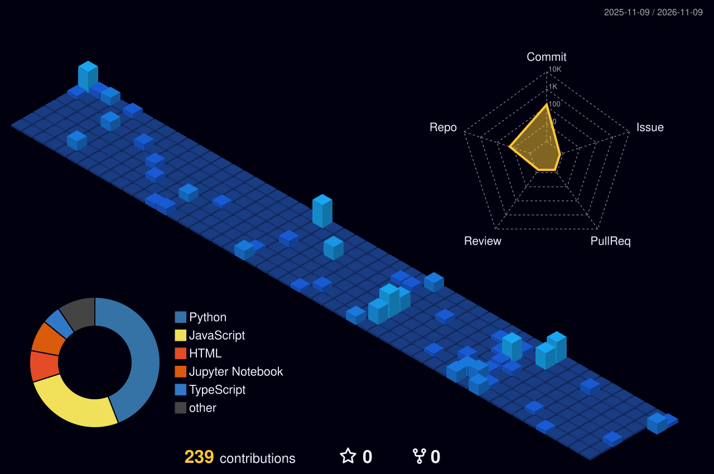

<h1 align="center">Hi 👋, I'm Megh Dave</h1>
<h3 align="center">ML Engineer · Robotics · Computer Vision · AI Research from Mumbai, India</h3>

  

- 🏆 **11× Hackathon Winner**

- 🚀 Engineer for **5+ startups**, from pre-seed to funded

- 🤖 Currently working on **SLAM, AI agents and LLM fine-tuning**

- 👨‍💻 All of my projects are available at [megh4tech.vercel.app](https://megh4tech.vercel.app/)

- 💬 Ask me about **ML, Robotics, Computer Vision, AI Agents**

- 🧑‍🏫 ML mentor at **DJS Compute**

- 📫 How to reach me **meghdave2006@gmail.com**

  
  
  

 

---

## Startup experience

I've been the engineer for **5+ startups**, from pre-seed teams finding their first product to funded companies scaling it. I don't just consult; I build and own the systems they run on:

| What I built for startups | Scope |
|---|---|
| **SLAM & sensor-fusion pipelines** | Visual-inertial odometry, camera + IMU fusion, mapping and localisation on real-world data |
| **Computer vision systems** | Detection and segmentation models, taken from data and training to deployment |
| **AI agents & LLM features** | Agent workflows, RAG, fine-tuned models, evaluation pipelines |
| **Full products, MVP to production** | Backend, APIs, auth, databases, front end, cloud deployment |

Most of this is closed-source client work. The projects below are the public side of it.

---

## Tech stack

  
   
  
   
  

  
  
  
  
  
  
  
  

---

## Featured projects

<table>
<tr>
<td width="50%" valign="top">

### [Forge](https://forge-surfaces-mauve.vercel.app/)
`Winner · Codex Community Hackathon`

Autonomous engineering org in a box. A swarm of Codex agents builds the product in parallel, an eval gate drops the weak attempts, and the best one deploys itself and self-heals.

**Stack:** Agent Swarm · Codex · Eval Gate · CI/CD

</td>
<td width="50%" valign="top">

### [EasyOffRoad](https://megh4tech.vercel.app/)
`Winner · Hawkathon 2026`

Perception for off-road autonomous vehicles. Semantic segmentation of desert terrain using Mask2Former on a Swin-Large backbone, with test-time augmentation.

**Stack:** PyTorch · Mask2Former · Swin-L · Next.js

</td>
</tr>
<tr>
<td width="50%" valign="top">

### [LawTune](https://github.com/MEGH06/LawTune)
`Fine-tuning · On-device`

Legal assistant in 22 Indian languages that runs offline on a phone. Gemma-2B fine-tuned with QLoRA and quantised to 4-bit.

**Stack:** Gemma-2B · QLoRA · MLX · Python

</td>
<td width="50%" valign="top">

### [Fincognia](https://fincogina.vercel.app/)
`Winner · Hackxios 2K25`

Agentic finance co-pilot for gig workers. Predicts liquidity risk with 85% accuracy and acts before an EMI default.

**Stack:** Agentic AI · Forecasting · Python

</td>
</tr>
<tr>
<td width="50%" valign="top">

### [LitAgent](https://litagent.vercel.app/)
`2nd Runner-Up · Hackanova 5.0`

Multi-agent research assistant. A 15-step pipeline over Semantic Scholar, arXiv and PubMed, with an LLM council that cross-checks claims.

**Stack:** LangChain · Multi-agent · RAG

</td>
<td width="50%" valign="top">

### [CyberSecure](https://redact-cybersecure-tau.vercel.app/)
`Team project · Security ML`

Intrusion detection over 1M+ network logs at 99%+ recall. Live PCAP capture, anomaly dashboards and Merkle-tree logging.

**Stack:** Scikit-learn · Next.js · Groq

</td>
</tr>
</table>

<b>More projects and research</b>

 

- **EcoSort AI** (Winner, Hackniche 4.0): real-time CV that identifies and sorts plastics. Roboflow, OpenCV, FastAPI
- **Equilibrium.ai** (Runner-Up, Datathon 2026): systemic-risk simulation for financial networks
- [**JigyasaAI**](https://github.com/MEGH06/JigyasaAI): multimodal RAG for PDFs (text + images). CLIP, ChromaDB
- [**Potato Leaf Detection**](https://github.com/MEGH06/Potato-leaf-detection): plant-disease CNN, 99%+ accuracy on PlantVillage
- **Research:** inverse PINNs for plant-transpiration modelling, an explainable ConvNeXt ensemble for cervical-cancer detection (presented), and federated learning (paper in progress)

---

## GitHub stats

  

  

