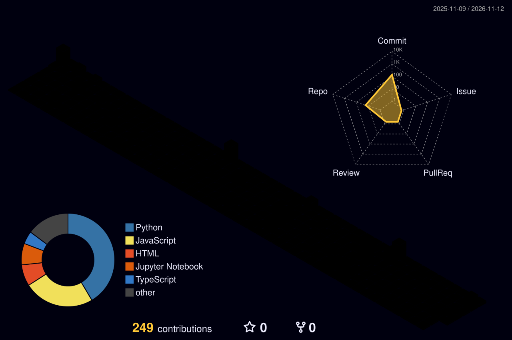

<!-- Generated from README.template.md by tools/build.py. Edit the template, not README.md. -->

<p align="center">
  <a href="https://megh4tech.vercel.app/"></a>
</p>

<p align="center">
  <a href="https://megh4tech.vercel.app/"></a>
</p>

<p align="center">
  <a href="https://megh4tech.vercel.app/"></a>
  <a href="https://www.linkedin.com/in/megh-dave-4a2227314/"></a>
  <a href="https://medium.com/@meghdave2006"></a>
  <a href="mailto:meghdave2006@gmail.com"></a>
</p>

<p align="center">
  
  
  
  
  
</p>

---

### ⚡ TL;DR

I'm **Megh**, an **AI/ML and full stack engineer** from Mumbai. I've worked with **5+ startups, from pre-seed to funded**, on everything from SLAM and spatial AI to agents, fine-tuned LLMs and production apps.
B.Tech CSE (Data Science) at **D.J. Sanghvi**, with Honours in Computational Finance. I've won a lot of hackathons along the way.

---

### 🧭 What I do

| | Area | What that means |
|---|---|---|
| 🛰️ | **Spatial AI & SLAM** | Visual-inertial odometry (VIO), multi-sensor fusion, camera + IMU pipelines, 3D mapping and localisation from real-world capture |
| 📱 | **App development** | Full stack and mobile: Next.js, React, FastAPI, auth, databases, Docker, Terraform, shipped to production |
| 🤖 | **R&D on agents** | Multi-agent systems, agent swarms, eval gates, self-healing pipelines, LLM councils |
| 🎛️ | **Fine-tuning** | QLoRA, 4-bit quantisation, on-device LLMs (Gemma-2B on MLX), domain-adapted models |
| 👁️ | **Computer vision** | Segmentation (Mask2Former, Swin), detection, CLIP, explainable medical imaging |
| 📚 | **RAG & GenAI** | Multimodal retrieval, vector DBs, grounded LLM apps |

> 🟢 **Available for freelance and startup work.** Give me a hard problem and a deadline. [Let's talk ↓](#-hire-me)

---

### 🛠️ Featured work

<table>
<tr>
<td width="50%" valign="top">

#### 🏭 [Forge](https://forge-surfaces-mauve.vercel.app/)
**An autonomous engineering org in a box.** Describe it in plain English. A swarm of Codex agents builds it in parallel, an eval gate kills the weak attempts, and the result ships itself to a live URL. When it breaks, it heals itself.

🏆 **Winner, ChatGPT / Codex Community Hackathon**
`Agent Swarm` `Codex` `Eval Gate` `Self-healing` `CI/CD`

</td>
<td width="50%" valign="top">

#### 📚 [LitAgent](https://litagent.vercel.app/)
**A multi-agent researcher that reads the literature and writes the review.** It runs a 15-step pipeline across Semantic Scholar, arXiv and PubMed, detects contradictions between studies, and uses an "LLM Council" for peer-review-style debate.

🥉 **2nd Runner-Up, Hackanova 5.0**
`Multi-agent` `RAG` `LangChain` `LLMs`

</td>
</tr>
<tr>
<td width="50%" valign="top">

#### ⚖️ [LawTune](https://github.com/MEGH06/LawTune)
**A legal assistant that speaks 22 Indian languages and runs offline on a phone.** Gemma-2B fine-tuned with QLoRA and quantised to 4-bit for on-device inference.

`Gemma-2B` `QLoRA` `MLX` `4-bit quantisation` `On-device`

</td>
<td width="50%" valign="top">

#### 💸 [Fincognia](https://fincogina.vercel.app/)
**An agentic finance co-pilot for gig workers.** It predicts liquidity risk at **85% accuracy** and heads off EMI defaults before they happen.

🏆 **Winner, Hackxios 2K25 (Innovation track)**
`Agentic AI` `Forecasting` `FinTech`

</td>
</tr>
<tr>
<td width="50%" valign="top">

#### 🛡️ [CyberSecure](https://redact-cybersecure-tau.vercel.app/)
**Intrusion detection over 1M+ network logs at 99%+ recall.** PCAP and live Wireshark capture, anomaly dashboards, Merkle-tree immutable logging, and GenAI threat summaries. *(team project)*

`Next.js` `Scikit-learn` `Merkle Trees` `Groq`

</td>
<td width="50%" valign="top">

#### 🔎 [JigyasaAI](https://jigyasaai.streamlit.app/)
**Multimodal RAG for PDFs.** Ask a question and get back the relevant text *and* images in one answer.

`CLIP` `ChromaDB` `Cloudinary` `Streamlit`

[Code →](https://github.com/MEGH06/JigyasaAI)

</td>
</tr>
</table>

<details>
<summary><b>➕ More builds</b></summary>
<br/>

| Project | What it does | Stack |
|---|---|---|
| **EasyOffRoad** 🏆 | Off-road perception: semantic segmentation of desert terrain for autonomous vehicles | Mask2Former · Swin-Large · PyTorch · Next.js |
| **EcoSort AI** 🏆 | Real-time CV that identifies and sorts plastics, with automated EPR compliance reports | Roboflow · OpenCV · FastAPI · Next.js |
| **Equilibrium.ai** 🥈 | Simulates how systemic risk spreads through a network of financial institutions | ML pipeline · LLM · Backend |
| [**OopsIDidntStudy**](https://github.com/ketan-2905/ed_app) | A last-minute study platform with PanicNotes, CramBot and Quizzard | NLP · React · FastAPI |
| [**Potato Leaf Detection**](https://github.com/MEGH06/Potato-leaf-detection) | Plant-disease CNN with 99%+ accuracy on PlantVillage | PyTorch · TensorFlow · CNN |

</details>

---

### 🏆 Trophy cabinet

| Event | Result | Project |
|---|---|---|
| ChatGPT / Codex Community Hackathon | 🏆 **Winner** | Forge |
| Hackniche 4.0 | 🏆 **Winner** | EcoSort AI |
| Hawkathon 2026 | 🏆 **Winner** | EasyOffRoad |
| Hackxios 2K25 (Innovation track) | 🏆 **Winner** | Fincognia |
| Hackanova 5.0 | 🥉 2nd Runner-Up | LitAgent |
| Datathon 2026 | 🥈 Runner-Up | Equilibrium.ai |
| Co-Code Hackathon, DJ Sanghvi | 🥉 2nd Runner-Up | — |
| DJS Sanshodhan (research symposium) | 🥉 2nd Runner-Up | — |

<sub>The full list, with more podiums, is on <a href="https://megh4tech.vercel.app/">my portfolio</a>.</sub>

---

### 🔬 Research

- **Inverse Physics-Informed Neural Networks (PINNs)**: a framework that estimates hidden plant-transpiration parameters from time-series data. It uses LSTM temporal encoding and TimeGAN perturbation so it still works on sparse, noisy data and on climates it hasn't seen.
- **Explainable ConvNeXt ensemble for cervical-cancer detection** *(presented)*: SHAP and attention analysis, so clinicians can question the prediction instead of just trusting it.
- **Federated learning** *(ongoing, paper in progress)*: training across distributed devices without the raw data ever leaving them.

---

### 🧰 Stack

<p align="center">
  <br/>
  
</p>

<p align="center">
  
  
  
  
  
  
  
  
  
  
  
</p>

```bash
$ whoami
megh dave: ai/ml + full stack engineer, part researcher, part hackathon goblin

$ cat focus.txt
SLAM / VIO · agentic AI · fine-tuning · computer vision · RAG · apps

$ cat superpower.txt
"I'm water." Drop me into any stack and I take its shape.

$ uptime
caffeinated since forever ☕   # 200+ juniors mentored at DJS Compute along the way
```

---

### 🧪 How I build


---

### 📊 Proof of work

<p align="center">
  
  
</p>
<p align="center">
  
</p>

<p align="center">
  
</p>

<p align="center">
  <picture>
    <source media="(prefers-color-scheme: dark)" srcset="https://raw.githubusercontent.com/MEGH06/MEGH06/output/github-snake-dark.svg"/>
    
  </picture>
</p>

---

<details>
<summary><b>🕹️ Easter egg: spin my brain in 3D (drag to rotate)</b></summary>
<br/>

A neural network you can rotate, generated by [`tools/gen_neural_stl.py`](./tools/gen_neural_stl.py).

```stl
solid neural_net
facet normal 0.577 0.577 0.577
outer loop
vertex -21.00 -7.00 -2.32
vertex -19.40 -7.00 -3.92
vertex -21.00 -5.40 -3.92
endloop
endfacet
facet normal 0.577 0.577 -0.577
outer loop
vertex -21.00 -7.00 -5.52
vertex -21.00 -5.40 -3.92
vertex -19.40 -7.00 -3.92
endloop
endfacet
facet normal -0.577 0.577 0.577
outer loop
vertex -21.00 -7.00 -2.32
vertex -21.00 -5.40 -3.92
vertex -22.60 -7.00 -3.92
endloop
endfacet
facet normal -0.577 0.577 -0.577
outer loop
vertex -21.00 -7.00 -5.52
vertex -22.60 -7.00 -3.92
vertex -21.00 -5.40 -3.92
endloop
endfacet
facet normal -0.577 -0.577 0.577
outer loop
vertex -21.00 -7.00 -2.32
vertex -22.60 -7.00 -3.92
vertex -21.00 -8.60 -3.92
endloop
endfacet
facet normal -0.577 -0.577 -0.577
outer loop
vertex -21.00 -7.00 -5.52
vertex -21.00 -8.60 -3.92
vertex -22.60 -7.00 -3.92
endloop
endfacet
facet normal 0.577 -0.577 0.577
outer loop
vertex -21.00 -7.00 -2.32
vertex -21.00 -8.60 -3.92
vertex -19.40 -7.00 -3.92
endloop
endfacet
facet normal 0.577 -0.577 -0.577
outer loop
vertex -21.00 -7.00 -5.52
vertex -19.40 -7.00 -3.92
vertex -21.00 -8.60 -3.92
endloop
endfacet
facet normal 0.577 0.577 0.577
outer loop
vertex -21.00 0.00 1.60
vertex -19.40 0.00 0.00
vertex -21.00 1.60 0.00
endloop
endfacet
facet normal 0.577 0.577 -0.577
outer loop
vertex -21.00 0.00 -1.60
vertex -21.00 1.60 0.00
vertex -19.40 0.00 0.00
endloop
endfacet
facet normal -0.577 0.577 0.577
outer loop
vertex -21.00 0.00 1.60
vertex -21.00 1.60 0.00
vertex -22.60 0.00 0.00
endloop
endfacet
facet normal -0.577 0.577 -0.577
outer loop
vertex -21.00 0.00 -1.60
vertex -22.60 0.00 0.00
vertex -21.00 1.60 0.00
endloop
endfacet
facet normal -0.577 -0.577 0.577
outer loop
vertex -21.00 0.00 1.60
vertex -22.60 0.00 0.00
vertex -21.00 -1.60 0.00
endloop
endfacet
facet normal -0.577 -0.577 -0.577
outer loop
vertex -21.00 0.00 -1.60
vertex -21.00 -1.60 0.00
vertex -22.60 0.00 0.00
endloop
endfacet
facet normal 0.577 -0.577 0.577
outer loop
vertex -21.00 0.00 1.60
vertex -21.00 -1.60 0.00
vertex -19.40 0.00 0.00
endloop
endfacet
facet normal 0.577 -0.577 -0.577
outer loop
vertex -21.00 0.00 -1.60
vertex -19.40 0.00 0.00
vertex -21.00 -1.60 0.00
endloop
endfacet
facet normal 0.577 0.577 0.577
outer loop
vertex -21.00 7.00 -2.32
vertex -19.40 7.00 -3.92
vertex -21.00 8.60 -3.92
endloop
endfacet
facet normal 0.577 0.577 -0.577
outer loop
vertex -21.00 7.00 -5.52
vertex -21.00 8.60 -3.92
vertex -19.40 7.00 -3.92
endloop
endfacet
facet normal -0.577 0.577 0.577
outer loop
vertex -21.00 7.00 -2.32
vertex -21.00 8.60 -3.92
vertex -22.60 7.00 -3.92
endloop
endfacet
facet normal -0.577 0.577 -0.577
outer loop
vertex -21.00 7.00 -5.52
vertex -22.60 7.00 -3.92
vertex -21.00 8.60 -3.92
endloop
endfacet
facet normal -0.577 -0.577 0.577
outer loop
vertex -21.00 7.00 -2.32
vertex -22.60 7.00 -3.92
vertex -21.00 5.40 -3.92
endloop
endfacet
facet normal -0.577 -0.577 -0.577
outer loop
vertex -21.00 7.00 -5.52
vertex -21.00 5.40 -3.92
vertex -22.60 7.00 -3.92
endloop
endfacet
facet normal 0.577 -0.577 0.577
outer loop
vertex -21.00 7.00 -2.32
vertex -21.00 5.40 -3.92
vertex -19.40 7.00 -3.92
endloop
endfacet
facet normal 0.577 -0.577 -0.577
outer loop
vertex -21.00 7.00 -5.52
vertex -19.40 7.00 -3.92
vertex -21.00 5.40 -3.92
endloop
endfacet
facet normal 0.577 0.577 0.577
outer loop
vertex -7.00 -14.00 -14.08
vertex -5.40 -14.00 -15.68
vertex -7.00 -12.40 -15.68
endloop
endfacet
facet normal 0.577 0.577 -0.577
outer loop
vertex -7.00 -14.00 -17.28
vertex -7.00 -12.40 -15.68
vertex -5.40 -14.00 -15.68
endloop
endfacet
facet normal -0.577 0.577 0.577
outer loop
vertex -7.00 -14.00 -14.08
vertex -7.00 -12.40 -15.68
vertex -8.60 -14.00 -15.68
endloop
endfacet
facet normal -0.577 0.577 -0.577
outer loop
vertex -7.00 -14.00 -17.28
vertex -8.60 -14.00 -15.68
vertex -7.00 -12.40 -15.68
endloop
endfacet
facet normal -0.577 -0.577 0.577
outer loop
vertex -7.00 -14.00 -14.08
vertex -8.60 -14.00 -15.68
vertex -7.00 -15.60 -15.68
endloop
endfacet
facet normal -0.577 -0.577 -0.577
outer loop
vertex -7.00 -14.00 -17.28
vertex -7.00 -15.60 -15.68
vertex -8.60 -14.00 -15.68
endloop
endfacet
facet normal 0.577 -0.577 0.577
outer loop
vertex -7.00 -14.00 -14.08
vertex -7.00 -15.60 -15.68
vertex -5.40 -14.00 -15.68
endloop
endfacet
facet normal 0.577 -0.577 -0.577
outer loop
vertex -7.00 -14.00 -17.28
vertex -5.40 -14.00 -15.68
vertex -7.00 -15.60 -15.68
endloop
endfacet
facet normal 0.577 0.577 0.577
outer loop
vertex -7.00 -7.00 -2.32
vertex -5.40 -7.00 -3.92
vertex -7.00 -5.40 -3.92
endloop
endfacet
facet normal 0.577 0.577 -0.577
outer loop
vertex -7.00 -7.00 -5.52
vertex -7.00 -5.40 -3.92
vertex -5.40 -7.00 -3.92
endloop
endfacet
facet normal -0.577 0.577 0.577
outer loop
vertex -7.00 -7.00 -2.32
vertex -7.00 -5.40 -3.92
vertex -8.60 -7.00 -3.92
endloop
endfacet
facet normal -0.577 0.577 -0.577
outer loop
vertex -7.00 -7.00 -5.52
vertex -8.60 -7.00 -3.92
vertex -7.00 -5.40 -3.92
endloop
endfacet
facet normal -0.577 -0.577 0.577
outer loop
vertex -7.00 -7.00 -2.32
vertex -8.60 -7.00 -3.92
vertex -7.00 -8.60 -3.92
endloop
endfacet
facet normal -0.577 -0.577 -0.577
outer loop
vertex -7.00 -7.00 -5.52
vertex -7.00 -8.60 -3.92
vertex -8.60 -7.00 -3.92
endloop
endfacet
facet normal 0.577 -0.577 0.577
outer loop
vertex -7.00 -7.00 -2.32
vertex -7.00 -8.60 -3.92
vertex -5.40 -7.00 -3.92
endloop
endfacet
facet normal 0.577 -0.577 -0.577
outer loop
vertex -7.00 -7.00 -5.52
vertex -5.40 -7.00 -3.92
vertex -7.00 -8.60 -3.92
endloop
endfacet
facet normal 0.577 0.577 0.577
outer loop
vertex -7.00 0.00 1.60
vertex -5.40 0.00 0.00
vertex -7.00 1.60 0.00
endloop
endfacet
facet normal 0.577 0.577 -0.577
outer loop
vertex -7.00 0.00 -1.60
vertex -7.00 1.60 0.00
vertex -5.40 0.00 0.00
endloop
endfacet
facet normal -0.577 0.577 0.577
outer loop
vertex -7.00 0.00 1.60
vertex -7.00 1.60 0.00
vertex -8.60 0.00 0.00
endloop
endfacet
facet normal -0.577 0.577 -0.577
outer loop
vertex -7.00 0.00 -1.60
vertex -8.60 0.00 0.00
vertex -7.00 1.60 0.00
endloop
endfacet
facet normal -0.577 -0.577 0.577
outer loop
vertex -7.00 0.00 1.60
vertex -8.60 0.00 0.00
vertex -7.00 -1.60 0.00
endloop
endfacet
facet normal -0.577 -0.577 -0.577
outer loop
vertex -7.00 0.00 -1.60
vertex -7.00 -1.60 0.00
vertex -8.60 0.00 0.00
endloop
endfacet
facet normal 0.577 -0.577 0.577
outer loop
vertex -7.00 0.00 1.60
vertex -7.00 -1.60 0.00
vertex -5.40 0.00 0.00
endloop
endfacet
facet normal 0.577 -0.577 -0.577
outer loop
vertex -7.00 0.00 -1.60
vertex -5.40 0.00 0.00
vertex -7.00 -1.60 0.00
endloop
endfacet
facet normal 0.577 0.577 0.577
outer loop
vertex -7.00 7.00 -2.32
vertex -5.40 7.00 -3.92
vertex -7.00 8.60 -3.92
endloop
endfacet
facet normal 0.577 0.577 -0.577
outer loop
vertex -7.00 7.00 -5.52
vertex -7.00 8.60 -3.92
vertex -5.40 7.00 -3.92
endloop
endfacet
facet normal -0.577 0.577 0.577
outer loop
vertex -7.00 7.00 -2.32
vertex -7.00 8.60 -3.92
vertex -8.60 7.00 -3.92
endloop
endfacet
facet normal -0.577 0.577 -0.577
outer loop
vertex -7.00 7.00 -5.52
vertex -8.60 7.00 -3.92
vertex -7.00 8.60 -3.92
endloop
endfacet
facet normal -0.577 -0.577 0.577
outer loop
vertex -7.00 7.00 -2.32
vertex -8.60 7.00 -3.92
vertex -7.00 5.40 -3.92
endloop
endfacet
facet normal -0.577 -0.577 -0.577
outer loop
vertex -7.00 7.00 -5.52
vertex -7.00 5.40 -3.92
vertex -8.60 7.00 -3.92
endloop
endfacet
facet normal 0.577 -0.577 0.577
outer loop
vertex -7.00 7.00 -2.32
vertex -7.00 5.40 -3.92
vertex -5.40 7.00 -3.92
endloop
endfacet
facet normal 0.577 -0.577 -0.577
outer loop
vertex -7.00 7.00 -5.52
vertex -5.40 7.00 -3.92
vertex -7.00 5.40 -3.92
endloop
endfacet
facet normal 0.577 0.577 0.577
outer loop
vertex -7.00 14.00 -14.08
vertex -5.40 14.00 -15.68
vertex -7.00 15.60 -15.68
endloop
endfacet
facet normal 0.577 0.577 -0.577
outer loop
vertex -7.00 14.00 -17.28
vertex -7.00 15.60 -15.68
vertex -5.40 14.00 -15.68
endloop
endfacet
facet normal -0.577 0.577 0.577
outer loop
vertex -7.00 14.00 -14.08
vertex -7.00 15.60 -15.68
vertex -8.60 14.00 -15.68
endloop
endfacet
facet normal -0.577 0.577 -0.577
outer loop
vertex -7.00 14.00 -17.28
vertex -8.60 14.00 -15.68
vertex -7.00 15.60 -15.68
endloop
endfacet
facet normal -0.577 -0.577 0.577
outer loop
vertex -7.00 14.00 -14.08
vertex -8.60 14.00 -15.68
vertex -7.00 12.40 -15.68
endloop
endfacet
facet normal -0.577 -0.577 -0.577
outer loop
vertex -7.00 14.00 -17.28
vertex -7.00 12.40 -15.68
vertex -8.60 14.00 -15.68
endloop
endfacet
facet normal 0.577 -0.577 0.577
outer loop
vertex -7.00 14.00 -14.08
vertex -7.00 12.40 -15.68
vertex -5.40 14.00 -15.68
endloop
endfacet
facet normal 0.577 -0.577 -0.577
outer loop
vertex -7.00 14.00 -17.28
vertex -5.40 14.00 -15.68
vertex -7.00 12.40 -15.68
endloop
endfacet
facet normal 0.577 0.577 0.577
outer loop
vertex 7.00 -14.00 -14.08
vertex 8.60 -14.00 -15.68
vertex 7.00 -12.40 -15.68
endloop
endfacet
facet normal 0.577 0.577 -0.577
outer loop
vertex 7.00 -14.00 -17.28
vertex 7.00 -12.40 -15.68
vertex 8.60 -14.00 -15.68
endloop
endfacet
facet normal -0.577 0.577 0.577
outer loop
vertex 7.00 -14.00 -14.08
vertex 7.00 -12.40 -15.68
vertex 5.40 -14.00 -15.68
endloop
endfacet
facet normal -0.577 0.577 -0.577
outer loop
vertex 7.00 -14.00 -17.28
vertex 5.40 -14.00 -15.68
vertex 7.00 -12.40 -15.68
endloop
endfacet
facet normal -0.577 -0.577 0.577
outer loop
vertex 7.00 -14.00 -14.08
vertex 5.40 -14.00 -15.68
vertex 7.00 -15.60 -15.68
endloop
endfacet
facet normal -0.577 -0.577 -0.577
outer loop
vertex 7.00 -14.00 -17.28
vertex 7.00 -15.60 -15.68
vertex 5.40 -14.00 -15.68
endloop
endfacet
facet normal 0.577 -0.577 0.577
outer loop
vertex 7.00 -14.00 -14.08
vertex 7.00 -15.60 -15.68
vertex 8.60 -14.00 -15.68
endloop
endfacet
facet normal 0.577 -0.577 -0.577
outer loop
vertex 7.00 -14.00 -17.28
vertex 8.60 -14.00 -15.68
vertex 7.00 -15.60 -15.68
endloop
endfacet
facet normal 0.577 0.577 0.577
outer loop
vertex 7.00 -7.00 -2.32
vertex 8.60 -7.00 -3.92
vertex 7.00 -5.40 -3.92
endloop
endfacet
facet normal 0.577 0.577 -0.577
outer loop
vertex 7.00 -7.00 -5.52
vertex 7.00 -5.40 -3.92
vertex 8.60 -7.00 -3.92
endloop
endfacet
facet normal -0.577 0.577 0.577
outer loop
vertex 7.00 -7.00 -2.32
vertex 7.00 -5.40 -3.92
vertex 5.40 -7.00 -3.92
endloop
endfacet
facet normal -0.577 0.577 -0.577
outer loop
vertex 7.00 -7.00 -5.52
vertex 5.40 -7.00 -3.92
vertex 7.00 -5.40 -3.92
endloop
endfacet
facet normal -0.577 -0.577 0.577
outer loop
vertex 7.00 -7.00 -2.32
vertex 5.40 -7.00 -3.92
vertex 7.00 -8.60 -3.92
endloop
endfacet
facet normal -0.577 -0.577 -0.577
outer loop
vertex 7.00 -7.00 -5.52
vertex 7.00 -8.60 -3.92
vertex 5.40 -7.00 -3.92
endloop
endfacet
facet normal 0.577 -0.577 0.577
outer loop
vertex 7.00 -7.00 -2.32
vertex 7.00 -8.60 -3.92
vertex 8.60 -7.00 -3.92
endloop
endfacet
facet normal 0.577 -0.577 -0.577
outer loop
vertex 7.00 -7.00 -5.52
vertex 8.60 -7.00 -3.92
vertex 7.00 -8.60 -3.92
endloop
endfacet
facet normal 0.577 0.577 0.577
outer loop
vertex 7.00 0.00 1.60
vertex 8.60 0.00 0.00
vertex 7.00 1.60 0.00
endloop
endfacet
facet normal 0.577 0.577 -0.577
outer loop
vertex 7.00 0.00 -1.60
vertex 7.00 1.60 0.00
vertex 8.60 0.00 0.00
endloop
endfacet
facet normal -0.577 0.577 0.577
outer loop
vertex 7.00 0.00 1.60
vertex 7.00 1.60 0.00
vertex 5.40 0.00 0.00
endloop
endfacet
facet normal -0.577 0.577 -0.577
outer loop
vertex 7.00 0.00 -1.60
vertex 5.40 0.00 0.00
vertex 7.00 1.60 0.00
endloop
endfacet
facet normal -0.577 -0.577 0.577
outer loop
vertex 7.00 0.00 1.60
vertex 5.40 0.00 0.00
vertex 7.00 -1.60 0.00
endloop
endfacet
facet normal -0.577 -0.577 -0.577
outer loop
vertex 7.00 0.00 -1.60
vertex 7.00 -1.60 0.00
vertex 5.40 0.00 0.00
endloop
endfacet
facet normal 0.577 -0.577 0.577
outer loop
vertex 7.00 0.00 1.60
vertex 7.00 -1.60 0.00
vertex 8.60 0.00 0.00
endloop
endfacet
facet normal 0.577 -0.577 -0.577
outer loop
vertex 7.00 0.00 -1.60
vertex 8.60 0.00 0.00
vertex 7.00 -1.60 0.00
endloop
endfacet
facet normal 0.577 0.577 0.577
outer loop
vertex 7.00 7.00 -2.32
vertex 8.60 7.00 -3.92
vertex 7.00 8.60 -3.92
endloop
endfacet
facet normal 0.577 0.577 -0.577
outer loop
vertex 7.00 7.00 -5.52
vertex 7.00 8.60 -3.92
vertex 8.60 7.00 -3.92
endloop
endfacet
facet normal -0.577 0.577 0.577
outer loop
vertex 7.00 7.00 -2.32
vertex 7.00 8.60 -3.92
vertex 5.40 7.00 -3.92
endloop
endfacet
facet normal -0.577 0.577 -0.577
outer loop
vertex 7.00 7.00 -5.52
vertex 5.40 7.00 -3.92
vertex 7.00 8.60 -3.92
endloop
endfacet
facet normal -0.577 -0.577 0.577
outer loop
vertex 7.00 7.00 -2.32
vertex 5.40 7.00 -3.92
vertex 7.00 5.40 -3.92
endloop
endfacet
facet normal -0.577 -0.577 -0.577
outer loop
vertex 7.00 7.00 -5.52
vertex 7.00 5.40 -3.92
vertex 5.40 7.00 -3.92
endloop
endfacet
facet normal 0.577 -0.577 0.577
outer loop
vertex 7.00 7.00 -2.32
vertex 7.00 5.40 -3.92
vertex 8.60 7.00 -3.92
endloop
endfacet
facet normal 0.577 -0.577 -0.577
outer loop
vertex 7.00 7.00 -5.52
vertex 8.60 7.00 -3.92
vertex 7.00 5.40 -3.92
endloop
endfacet
facet normal 0.577 0.577 0.577
outer loop
vertex 7.00 14.00 -14.08
vertex 8.60 14.00 -15.68
vertex 7.00 15.60 -15.68
endloop
endfacet
facet normal 0.577 0.577 -0.577
outer loop
vertex 7.00 14.00 -17.28
vertex 7.00 15.60 -15.68
vertex 8.60 14.00 -15.68
endloop
endfacet
facet normal -0.577 0.577 0.577
outer loop
vertex 7.00 14.00 -14.08
vertex 7.00 15.60 -15.68
vertex 5.40 14.00 -15.68
endloop
endfacet
facet normal -0.577 0.577 -0.577
outer loop
vertex 7.00 14.00 -17.28
vertex 5.40 14.00 -15.68
vertex 7.00 15.60 -15.68
endloop
endfacet
facet normal -0.577 -0.577 0.577
outer loop
vertex 7.00 14.00 -14.08
vertex 5.40 14.00 -15.68
vertex 7.00 12.40 -15.68
endloop
endfacet
facet normal -0.577 -0.577 -0.577
outer loop
vertex 7.00 14.00 -17.28
vertex 7.00 12.40 -15.68
vertex 5.40 14.00 -15.68
endloop
endfacet
facet normal 0.577 -0.577 0.577
outer loop
vertex 7.00 14.00 -14.08
vertex 7.00 12.40 -15.68
vertex 8.60 14.00 -15.68
endloop
endfacet
facet normal 0.577 -0.577 -0.577
outer loop
vertex 7.00 14.00 -17.28
vertex 8.60 14.00 -15.68
vertex 7.00 12.40 -15.68
endloop
endfacet
facet normal 0.577 0.577 0.577
outer loop
vertex 21.00 -3.50 0.62
vertex 22.60 -3.50 -0.98
vertex 21.00 -1.90 -0.98
endloop
endfacet
facet normal 0.577 0.577 -0.577
outer loop
vertex 21.00 -3.50 -2.58
vertex 21.00 -1.90 -0.98
vertex 22.60 -3.50 -0.98
endloop
endfacet
facet normal -0.577 0.577 0.577
outer loop
vertex 21.00 -3.50 0.62
vertex 21.00 -1.90 -0.98
vertex 19.40 -3.50 -0.98
endloop
endfacet
facet normal -0.577 0.577 -0.577
outer loop
vertex 21.00 -3.50 -2.58
vertex 19.40 -3.50 -0.98
vertex 21.00 -1.90 -0.98
endloop
endfacet
facet normal -0.577 -0.577 0.577
outer loop
vertex 21.00 -3.50 0.62
vertex 19.40 -3.50 -0.98
vertex 21.00 -5.10 -0.98
endloop
endfacet
facet normal -0.577 -0.577 -0.577
outer loop
vertex 21.00 -3.50 -2.58
vertex 21.00 -5.10 -0.98
vertex 19.40 -3.50 -0.98
endloop
endfacet
facet normal 0.577 -0.577 0.577
outer loop
vertex 21.00 -3.50 0.62
vertex 21.00 -5.10 -0.98
vertex 22.60 -3.50 -0.98
endloop
endfacet
facet normal 0.577 -0.577 -0.577
outer loop
vertex 21.00 -3.50 -2.58
vertex 22.60 -3.50 -0.98
vertex 21.00 -5.10 -0.98
endloop
endfacet
facet normal 0.577 0.577 0.577
outer loop
vertex 21.00 3.50 0.62
vertex 22.60 3.50 -0.98
vertex 21.00 5.10 -0.98
endloop
endfacet
facet normal 0.577 0.577 -0.577
outer loop
vertex 21.00 3.50 -2.58
vertex 21.00 5.10 -0.98
vertex 22.60 3.50 -0.98
endloop
endfacet
facet normal -0.577 0.577 0.577
outer loop
vertex 21.00 3.50 0.62
vertex 21.00 5.10 -0.98
vertex 19.40 3.50 -0.98
endloop
endfacet
facet normal -0.577 0.577 -0.577
outer loop
vertex 21.00 3.50 -2.58
vertex 19.40 3.50 -0.98
vertex 21.00 5.10 -0.98
endloop
endfacet
facet normal -0.577 -0.577 0.577
outer loop
vertex 21.00 3.50 0.62
vertex 19.40 3.50 -0.98
vertex 21.00 1.90 -0.98
endloop
endfacet
facet normal -0.577 -0.577 -0.577
outer loop
vertex 21.00 3.50 -2.58
vertex 21.00 1.90 -0.98
vertex 19.40 3.50 -0.98
endloop
endfacet
facet normal 0.577 -0.577 0.577
outer loop
vertex 21.00 3.50 0.62
vertex 21.00 1.90 -0.98
vertex 22.60 3.50 -0.98
endloop
endfacet
facet normal 0.577 -0.577 -0.577
outer loop
vertex 21.00 3.50 -2.58
vertex 22.60 3.50 -0.98
vertex 21.00 1.90 -0.98
endloop
endfacet
facet normal -0.689 -0.215 -0.692
outer loop
vertex -21.10 -7.20 -3.92
vertex -21.05 -6.85 -4.07
vertex -7.05 -13.85 -15.83
endloop
endfacet
facet normal -0.689 -0.215 -0.692
outer loop
vertex -21.10 -7.20 -3.92
vertex -7.05 -13.85 -15.83
vertex -7.10 -14.20 -15.68
endloop
endfacet
facet normal 0.447 0.894 0.000
outer loop
vertex -21.05 -6.85 -4.07
vertex -20.85 -6.95 -3.77
vertex -6.85 -13.95 -15.53
endloop
endfacet
facet normal 0.447 0.894 -0.000
outer loop
vertex -21.05 -6.85 -4.07
vertex -6.85 -13.95 -15.53
vertex -7.05 -13.85 -15.83
endloop
endfacet
facet normal 0.242 -0.680 0.692
outer loop
vertex -20.85 -6.95 -3.77
vertex -21.10 -7.20 -3.92
vertex -7.10 -14.20 -15.68
endloop
endfacet
facet normal 0.242 -0.680 0.692
outer loop
vertex -20.85 -6.95 -3.77
vertex -7.10 -14.20 -15.68
vertex -6.85 -13.95 -15.53
endloop
endfacet
facet normal 0.000 -0.500 -0.866
outer loop
vertex -21.00 -7.22 -3.92
vertex -21.00 -6.89 -4.11
vertex -7.00 -6.89 -4.11
endloop
endfacet
facet normal 0.000 -0.500 -0.866
outer loop
vertex -21.00 -7.22 -3.92
vertex -7.00 -6.89 -4.11
vertex -7.00 -7.22 -3.92
endloop
endfacet
facet normal 0.000 1.000 0.000
outer loop
vertex -21.00 -6.89 -4.11
vertex -21.00 -6.89 -3.73
vertex -7.00 -6.89 -3.73
endloop
endfacet
facet normal 0.000 1.000 0.000
outer loop
vertex -21.00 -6.89 -4.11
vertex -7.00 -6.89 -3.73
vertex -7.00 -6.89 -4.11
endloop
endfacet
facet normal 0.000 -0.500 0.866
outer loop
vertex -21.00 -6.89 -3.73
vertex -21.00 -7.22 -3.92
vertex -7.00 -7.22 -3.92
endloop
endfacet
facet normal 0.000 -0.500 0.866
outer loop
vertex -21.00 -6.89 -3.73
vertex -7.00 -7.22 -3.92
vertex -7.00 -6.89 -3.73
endloop
endfacet
facet normal 0.412 -0.353 -0.840
outer loop
vertex -20.90 -7.20 -3.92
vertex -21.01 -6.88 -4.10
vertex -7.01 0.12 -0.18
endloop
endfacet
facet normal 0.412 -0.353 -0.840
outer loop
vertex -20.90 -7.20 -3.92
vertex -7.01 0.12 -0.18
vertex -6.90 -0.20 0.00
endloop
endfacet
facet normal -0.447 0.894 -0.000
outer loop
vertex -21.01 -6.88 -4.10
vertex -21.09 -6.92 -3.74
vertex -7.09 0.08 0.18
endloop
endfacet
facet normal -0.447 0.894 0.000
outer loop
vertex -21.01 -6.88 -4.10
vertex -7.09 0.08 0.18
vertex -7.01 0.12 -0.18
endloop
endfacet
facet normal 0.035 -0.541 0.840
outer loop
vertex -21.09 -6.92 -3.74
vertex -20.90 -7.20 -3.92
vertex -6.90 -0.20 0.00
endloop
endfacet
facet normal 0.035 -0.541 0.840
outer loop
vertex -21.09 -6.92 -3.74
vertex -6.90 -0.20 0.00
vertex -7.09 0.08 0.18
endloop
endfacet
facet normal 0.354 -0.354 -0.866
outer loop
vertex -20.84 -7.16 -3.92
vertex -21.08 -6.92 -4.11
vertex -7.08 7.08 -4.11
endloop
endfacet
facet normal 0.354 -0.354 -0.866
outer loop
vertex -20.84 -7.16 -3.92
vertex -7.08 7.08 -4.11
vertex -6.84 6.84 -3.92
endloop
endfacet
facet normal -0.707 0.707 0.000
outer loop
vertex -21.08 -6.92 -4.11
vertex -21.08 -6.92 -3.73
vertex -7.08 7.08 -3.73
endloop
endfacet
facet normal -0.707 0.707 0.000
outer loop
vertex -21.08 -6.92 -4.11
vertex -7.08 7.08 -3.73
vertex -7.08 7.08 -4.11
endloop
endfacet
facet normal 0.354 -0.354 0.866
outer loop
vertex -21.08 -6.92 -3.73
vertex -20.84 -7.16 -3.92
vertex -6.84 6.84 -3.92
endloop
endfacet
facet normal 0.354 -0.354 0.866
outer loop
vertex -21.08 -6.92 -3.73
vertex -6.84 6.84 -3.92
vertex -7.08 7.08 -3.73
endloop
endfacet
facet normal 0.213 -0.582 -0.785
outer loop
vertex -20.82 -7.12 -3.92
vertex -21.14 -7.01 -4.09
vertex -7.14 13.99 -15.85
endloop
endfacet
facet normal 0.213 -0.582 -0.785
outer loop
vertex -20.82 -7.12 -3.92
vertex -7.14 13.99 -15.85
vertex -6.82 13.88 -15.68
endloop
endfacet
facet normal -0.832 0.555 -0.000
outer loop
vertex -21.14 -7.01 -4.09
vertex -21.05 -6.87 -3.75
vertex -7.05 14.13 -15.51
endloop
endfacet
facet normal -0.832 0.555 -0.000
outer loop
vertex -21.14 -7.01 -4.09
vertex -7.05 14.13 -15.51
vertex -7.14 13.99 -15.85
endloop
endfacet
facet normal 0.619 0.027 0.785
outer loop
vertex -21.05 -6.87 -3.75
vertex -20.82 -7.12 -3.92
vertex -6.82 13.88 -15.68
endloop
endfacet
facet normal 0.619 0.027 0.785
outer loop
vertex -21.05 -6.87 -3.75
vertex -6.82 13.88 -15.68
vertex -7.05 14.13 -15.51
endloop
endfacet
facet normal -0.734 0.027 -0.679
outer loop
vertex -21.16 -0.16 0.00
vertex -21.01 0.16 -0.15
vertex -7.01 -13.84 -15.83
endloop
endfacet
facet normal -0.734 0.027 -0.679
outer loop
vertex -21.16 -0.16 0.00
vertex -7.01 -13.84 -15.83
vertex -7.16 -14.16 -15.68
endloop
endfacet
facet normal 0.707 0.707 -0.000
outer loop
vertex -21.01 0.16 -0.15
vertex -20.84 -0.01 0.15
vertex -6.84 -14.01 -15.53
endloop
endfacet
facet normal 0.707 0.707 0.000
outer loop
vertex -21.01 0.16 -0.15
vertex -6.84 -14.01 -15.53
vertex -7.01 -13.84 -15.83
endloop
endfacet
facet normal 0.027 -0.734 0.679
outer loop
vertex -20.84 -0.01 0.15
vertex -21.16 -0.16 0.00
vertex -7.16 -14.16 -15.68
endloop
endfacet
facet normal 0.027 -0.734 0.679
outer loop
vertex -20.84 -0.01 0.15
vertex -7.16 -14.16 -15.68
vertex -6.84 -14.01 -15.53
endloop
endfacet
facet normal -0.412 -0.353 -0.840
outer loop
vertex -21.10 -0.20 0.00
vertex -20.99 0.12 -0.18
vertex -6.99 -6.88 -4.10
endloop
endfacet
facet normal -0.412 -0.353 -0.840
outer loop
vertex -21.10 -0.20 0.00
vertex -6.99 -6.88 -4.10
vertex -7.10 -7.20 -3.92
endloop
endfacet
facet normal 0.447 0.894 -0.000
outer loop
vertex -20.99 0.12 -0.18
vertex -20.91 0.08 0.18
vertex -6.91 -6.92 -3.74
endloop
endfacet
facet normal 0.447 0.894 0.000
outer loop
vertex -20.99 0.12 -0.18
vertex -6.91 -6.92 -3.74
vertex -6.99 -6.88 -4.10
endloop
endfacet
facet normal -0.035 -0.541 0.840
outer loop
vertex -20.91 0.08 0.18
vertex -21.10 -0.20 0.00
vertex -7.10 -7.20 -3.92
endloop
endfacet
facet normal -0.035 -0.541 0.840
outer loop
vertex -20.91 0.08 0.18
vertex -7.10 -7.20 -3.92
vertex -6.91 -6.92 -3.74
endloop
endfacet
facet normal 0.000 -0.500 -0.866
outer loop
vertex -21.00 -0.22 0.00
vertex -21.00 0.11 -0.19
vertex -7.00 0.11 -0.19
endloop
endfacet
facet normal 0.000 -0.500 -0.866
outer loop
vertex -21.00 -0.22 0.00
vertex -7.00 0.11 -0.19
vertex -7.00 -0.22 0.00
endloop
endfacet
facet normal 0.000 1.000 -0.000
outer loop
vertex -21.00 0.11 -0.19
vertex -21.00 0.11 0.19
vertex -7.00 0.11 0.19
endloop
endfacet
facet normal 0.000 1.000 -0.000
outer loop
vertex -21.00 0.11 -0.19
vertex -7.00 0.11 0.19
vertex -7.00 0.11 -0.19
endloop
endfacet
facet normal 0.000 -0.500 0.866
outer loop
vertex -21.00 0.11 0.19
vertex -21.00 -0.22 0.00
vertex -7.00 -0.22 0.00
endloop
endfacet
facet normal 0.000 -0.500 0.866
outer loop
vertex -21.00 0.11 0.19
vertex -7.00 -0.22 0.00
vertex -7.00 0.11 0.19
endloop
endfacet
facet normal 0.035 -0.541 -0.840
outer loop
vertex -20.90 -0.20 0.00
vertex -21.09 0.08 -0.18
vertex -7.09 7.08 -4.10
endloop
endfacet
facet normal 0.035 -0.541 -0.840
outer loop
vertex -20.90 -0.20 0.00
vertex -7.09 7.08 -4.10
vertex -6.90 6.80 -3.92
endloop
endfacet
facet normal -0.447 0.894 0.000
outer loop
vertex -21.09 0.08 -0.18
vertex -21.01 0.12 0.18
vertex -7.01 7.12 -3.74
endloop
endfacet
facet normal -0.447 0.894 -0.000
outer loop
vertex -21.09 0.08 -0.18
vertex -7.01 7.12 -3.74
vertex -7.09 7.08 -4.10
endloop
endfacet
facet normal 0.412 -0.353 0.840
outer loop
vertex -21.01 0.12 0.18
vertex -20.90 -0.20 0.00
vertex -6.90 6.80 -3.92
endloop
endfacet
facet normal 0.412 -0.353 0.840
outer loop
vertex -21.01 0.12 0.18
vertex -6.90 6.80 -3.92
vertex -7.01 7.12 -3.74
endloop
endfacet
facet normal -0.027 -0.734 -0.679
outer loop
vertex -20.84 -0.16 0.00
vertex -21.16 -0.01 -0.15
vertex -7.16 13.99 -15.83
endloop
endfacet
facet normal -0.027 -0.734 -0.679
outer loop
vertex -20.84 -0.16 0.00
vertex -7.16 13.99 -15.83
vertex -6.84 13.84 -15.68
endloop
endfacet
facet normal -0.707 0.707 0.000
outer loop
vertex -21.16 -0.01 -0.15
vertex -20.99 0.16 0.15
vertex -6.99 14.16 -15.53
endloop
endfacet
facet normal -0.707 0.707 -0.000
outer loop
vertex -21.16 -0.01 -0.15
vertex -6.99 14.16 -15.53
vertex -7.16 13.99 -15.83
endloop
endfacet
facet normal 0.734 0.027 0.679
outer loop
vertex -20.99 0.16 0.15
vertex -20.84 -0.16 0.00
vertex -6.84 13.84 -15.68
endloop
endfacet
facet normal 0.734 0.027 0.679
outer loop
vertex -20.99 0.16 0.15
vertex -6.84 13.84 -15.68
vertex -6.99 14.16 -15.53
endloop
endfacet
facet normal -0.619 0.027 -0.785
outer loop
vertex -21.18 6.88 -3.92
vertex -20.95 7.13 -4.09
vertex -6.95 -13.87 -15.85
endloop
endfacet
facet normal -0.619 0.027 -0.785
outer loop
vertex -21.18 6.88 -3.92
vertex -6.95 -13.87 -15.85
vertex -7.18 -14.12 -15.68
endloop
endfacet
facet normal 0.832 0.555 0.000
outer loop
vertex -20.95 7.13 -4.09
vertex -20.86 6.99 -3.75
vertex -6.86 -14.01 -15.51
endloop
endfacet
facet normal 0.832 0.555 0.000
outer loop
vertex -20.95 7.13 -4.09
vertex -6.86 -14.01 -15.51
vertex -6.95 -13.87 -15.85
endloop
endfacet
facet normal -0.213 -0.582 0.785
outer loop
vertex -20.86 6.99 -3.75
vertex -21.18 6.88 -3.92
vertex -7.18 -14.12 -15.68
endloop
endfacet
facet normal -0.213 -0.582 0.785
outer loop
vertex -20.86 6.99 -3.75
vertex -7.18 -14.12 -15.68
vertex -6.86 -14.01 -15.51
endloop
endfacet
facet normal -0.354 -0.354 -0.866
outer loop
vertex -21.16 6.84 -3.92
vertex -20.92 7.08 -4.11
vertex -6.92 -6.92 -4.11
endloop
endfacet
facet normal -0.354 -0.354 -0.866
outer loop
vertex -21.16 6.84 -3.92
vertex -6.92 -6.92 -4.11
vertex -7.16 -7.16 -3.92
endloop
endfacet
facet normal 0.707 0.707 -0.000
outer loop
vertex -20.92 7.08 -4.11
vertex -20.92 7.08 -3.73
vertex -6.92 -6.92 -3.73
endloop
endfacet
facet normal 0.707 0.707 0.000
outer loop
vertex -20.92 7.08 -4.11
vertex -6.92 -6.92 -3.73
vertex -6.92 -6.92 -4.11
endloop
endfacet
facet normal -0.354 -0.354 0.866
outer loop
vertex -20.92 7.08 -3.73
vertex -21.16 6.84 -3.92
vertex -7.16 -7.16 -3.92
endloop
endfacet
facet normal -0.354 -0.354 0.866
outer loop
vertex -20.92 7.08 -3.73
vertex -7.16 -7.16 -3.92
vertex -6.92 -6.92 -3.73
endloop
endfacet
facet normal -0.035 -0.541 -0.840
outer loop
vertex -21.10 6.80 -3.92
vertex -20.91 7.08 -4.10
vertex -6.91 0.08 -0.18
endloop
endfacet
facet normal -0.035 -0.541 -0.840
outer loop
vertex -21.10 6.80 -3.92
vertex -6.91 0.08 -0.18
vertex -7.10 -0.20 0.00
endloop
endfacet
facet normal 0.447 0.894 -0.000
outer loop
vertex -20.91 7.08 -4.10
vertex -20.99 7.12 -3.74
vertex -6.99 0.12 0.18
endloop
endfacet
facet normal 0.447 0.894 -0.000
outer loop
vertex -20.91 7.08 -4.10
vertex -6.99 0.12 0.18
vertex -6.91 0.08 -0.18
endloop
endfacet
facet normal -0.412 -0.353 0.840
outer loop
vertex -20.99 7.12 -3.74
vertex -21.10 6.80 -3.92
vertex -7.10 -0.20 0.00
endloop
endfacet
facet normal -0.412 -0.353 0.840
outer loop
vertex -20.99 7.12 -3.74
vertex -7.10 -0.20 0.00
vertex -6.99 0.12 0.18
endloop
endfacet
facet normal 0.000 -0.500 -0.866
outer loop
vertex -21.00 6.78 -3.92
vertex -21.00 7.11 -4.11
vertex -7.00 7.11 -4.11
endloop
endfacet
facet normal 0.000 -0.500 -0.866
outer loop
vertex -21.00 6.78 -3.92
vertex -7.00 7.11 -4.11
vertex -7.00 6.78 -3.92
endloop
endfacet
facet normal 0.000 1.000 0.000
outer loop
vertex -21.00 7.11 -4.11
vertex -21.00 7.11 -3.73
vertex -7.00 7.11 -3.73
endloop
endfacet
facet normal 0.000 1.000 0.000
outer loop
vertex -21.00 7.11 -4.11
vertex -7.00 7.11 -3.73
vertex -7.00 7.11 -4.11
endloop
endfacet
facet normal 0.000 -0.500 0.866
outer loop
vertex -21.00 7.11 -3.73
vertex -21.00 6.78 -3.92
vertex -7.00 6.78 -3.92
endloop
endfacet
facet normal 0.000 -0.500 0.866
outer loop
vertex -21.00 7.11 -3.73
vertex -7.00 6.78 -3.92
vertex -7.00 7.11 -3.73
endloop
endfacet
facet normal -0.242 -0.680 -0.692
outer loop
vertex -20.90 6.80 -3.92
vertex -21.15 7.05 -4.07
vertex -7.15 14.05 -15.83
endloop
endfacet
facet normal -0.242 -0.680 -0.692
outer loop
vertex -20.90 6.80 -3.92
vertex -7.15 14.05 -15.83
vertex -6.90 13.80 -15.68
endloop
endfacet
facet normal -0.447 0.894 -0.000
outer loop
vertex -21.15 7.05 -4.07
vertex -20.95 7.15 -3.77
vertex -6.95 14.15 -15.53
endloop
endfacet
facet normal -0.447 0.894 0.000
outer loop
vertex -21.15 7.05 -4.07
vertex -6.95 14.15 -15.53
vertex -7.15 14.05 -15.83
endloop
endfacet
facet normal 0.689 -0.215 0.692
outer loop
vertex -20.95 7.15 -3.77
vertex -20.90 6.80 -3.92
vertex -6.90 13.80 -15.68
endloop
endfacet
facet normal 0.689 -0.215 0.692
outer loop
vertex -20.95 7.15 -3.77
vertex -6.90 13.80 -15.68
vertex -6.95 14.15 -15.53
endloop
endfacet
facet normal 0.000 -0.500 -0.866
outer loop
vertex -7.00 -14.22 -15.68
vertex -7.00 -13.89 -15.87
vertex 7.00 -13.89 -15.87
endloop
endfacet
facet normal 0.000 -0.500 -0.866
outer loop
vertex -7.00 -14.22 -15.68
vertex 7.00 -13.89 -15.87
vertex 7.00 -14.22 -15.68
endloop
endfacet
facet normal 0.000 1.000 0.000
outer loop
vertex -7.00 -13.89 -15.87
vertex -7.00 -13.89 -15.49
vertex 7.00 -13.89 -15.49
endloop
endfacet
facet normal 0.000 1.000 0.000
outer loop
vertex -7.00 -13.89 -15.87
vertex 7.00 -13.89 -15.49
vertex 7.00 -13.89 -15.87
endloop
endfacet
facet normal 0.000 -0.500 0.866
outer loop
vertex -7.00 -13.89 -15.49
vertex -7.00 -14.22 -15.68
vertex 7.00 -14.22 -15.68
endloop
endfacet
facet normal 0.000 -0.500 0.866
outer loop
vertex -7.00 -13.89 -15.49
vertex 7.00 -14.22 -15.68
vertex 7.00 -13.89 -15.49
endloop
endfacet
facet normal 0.689 -0.215 -0.692
outer loop
vertex -6.90 -14.20 -15.68
vertex -6.95 -13.85 -15.83
vertex 7.05 -6.85 -4.07
endloop
endfacet
facet normal 0.689 -0.215 -0.692
outer loop
vertex -6.90 -14.20 -15.68
vertex 7.05 -6.85 -4.07
vertex 7.10 -7.20 -3.92
endloop
endfacet
facet normal -0.447 0.894 -0.000
outer loop
vertex -6.95 -13.85 -15.83
vertex -7.15 -13.95 -15.53
vertex 6.85 -6.95 -3.77
endloop
endfacet
facet normal -0.447 0.894 0.000
outer loop
vertex -6.95 -13.85 -15.83
vertex 6.85 -6.95 -3.77
vertex 7.05 -6.85 -4.07
endloop
endfacet
facet normal -0.242 -0.680 0.692
outer loop
vertex -7.15 -13.95 -15.53
vertex -6.90 -14.20 -15.68
vertex 7.10 -7.20 -3.92
endloop
endfacet
facet normal -0.242 -0.680 0.692
outer loop
vertex -7.15 -13.95 -15.53
vertex 7.10 -7.20 -3.92
vertex 6.85 -6.95 -3.77
endloop
endfacet
facet normal 0.734 0.027 -0.679
outer loop
vertex -6.84 -14.16 -15.68
vertex -6.99 -13.84 -15.83
vertex 7.01 0.16 -0.15
endloop
endfacet
facet normal 0.734 0.027 -0.679
outer loop
vertex -6.84 -14.16 -15.68
vertex 7.01 0.16 -0.15
vertex 7.16 -0.16 0.00
endloop
endfacet
facet normal -0.707 0.707 0.000
outer loop
vertex -6.99 -13.84 -15.83
vertex -7.16 -14.01 -15.53
vertex 6.84 -0.01 0.15
endloop
endfacet
facet normal -0.707 0.707 0.000
outer loop
vertex -6.99 -13.84 -15.83
vertex 6.84 -0.01 0.15
vertex 7.01 0.16 -0.15
endloop
endfacet
facet normal -0.027 -0.734 0.679
outer loop
vertex -7.16 -14.01 -15.53
vertex -6.84 -14.16 -15.68
vertex 7.16 -0.16 0.00
endloop
endfacet
facet normal -0.027 -0.734 0.679
outer loop
vertex -7.16 -14.01 -15.53
vertex 7.16 -0.16 0.00
vertex 6.84 -0.01 0.15
endloop
endfacet
facet normal 0.619 0.027 -0.785
outer loop
vertex -6.82 -14.12 -15.68
vertex -7.05 -13.87 -15.85
vertex 6.95 7.13 -4.09
endloop
endfacet
facet normal 0.619 0.027 -0.785
outer loop
vertex -6.82 -14.12 -15.68
vertex 6.95 7.13 -4.09
vertex 7.18 6.88 -3.92
endloop
endfacet
facet normal -0.832 0.555 -0.000
outer loop
vertex -7.05 -13.87 -15.85
vertex -7.14 -14.01 -15.51
vertex 6.86 6.99 -3.75
endloop
endfacet
facet normal -0.832 0.555 0.000
outer loop
vertex -7.05 -13.87 -15.85
vertex 6.86 6.99 -3.75
vertex 6.95 7.13 -4.09
endloop
endfacet
facet normal 0.213 -0.582 0.785
outer loop
vertex -7.14 -14.01 -15.51
vertex -6.82 -14.12 -15.68
vertex 7.18 6.88 -3.92
endloop
endfacet
facet normal 0.213 -0.582 0.785
outer loop
vertex -7.14 -14.01 -15.51
vertex 7.18 6.88 -3.92
vertex 6.86 6.99 -3.75
endloop
endfacet
facet normal 0.447 -0.224 -0.866
outer loop
vertex -6.80 -14.10 -15.68
vertex -7.10 -13.95 -15.87
vertex 6.90 14.05 -15.87
endloop
endfacet
facet normal 0.447 -0.224 -0.866
outer loop
vertex -6.80 -14.10 -15.68
vertex 6.90 14.05 -15.87
vertex 7.20 13.90 -15.68
endloop
endfacet
facet normal -0.894 0.447 0.000
outer loop
vertex -7.10 -13.95 -15.87
vertex -7.10 -13.95 -15.49
vertex 6.90 14.05 -15.49
endloop
endfacet
facet normal -0.894 0.447 0.000
outer loop
vertex -7.10 -13.95 -15.87
vertex 6.90 14.05 -15.49
vertex 6.90 14.05 -15.87
endloop
endfacet
facet normal 0.447 -0.224 0.866
outer loop
vertex -7.10 -13.95 -15.49
vertex -6.80 -14.10 -15.68
vertex 7.20 13.90 -15.68
endloop
endfacet
facet normal 0.447 -0.224 0.866
outer loop
vertex -7.10 -13.95 -15.49
vertex 7.20 13.90 -15.68
vertex 6.90 14.05 -15.49
endloop
endfacet
facet normal -0.689 -0.215 -0.692
outer loop
vertex -7.10 -7.20 -3.92
vertex -7.05 -6.85 -4.07
vertex 6.95 -13.85 -15.83
endloop
endfacet
facet normal -0.689 -0.215 -0.692
outer loop
vertex -7.10 -7.20 -3.92
vertex 6.95 -13.85 -15.83
vertex 6.90 -14.20 -15.68
endloop
endfacet
facet normal 0.447 0.894 0.000
outer loop
vertex -7.05 -6.85 -4.07
vertex -6.85 -6.95 -3.77
vertex 7.15 -13.95 -15.53
endloop
endfacet
facet normal 0.447 0.894 -0.000
outer loop
vertex -7.05 -6.85 -4.07
vertex 7.15 -13.95 -15.53
vertex 6.95 -13.85 -15.83
endloop
endfacet
facet normal 0.242 -0.680 0.692
outer loop
vertex -6.85 -6.95 -3.77
vertex -7.10 -7.20 -3.92
vertex 6.90 -14.20 -15.68
endloop
endfacet
facet normal 0.242 -0.680 0.692
outer loop
vertex -6.85 -6.95 -3.77
vertex 6.90 -14.20 -15.68
vertex 7.15 -13.95 -15.53
endloop
endfacet
facet normal 0.000 -0.500 -0.866
outer loop
vertex -7.00 -7.22 -3.92
vertex -7.00 -6.89 -4.11
vertex 7.00 -6.89 -4.11
endloop
endfacet
facet normal 0.000 -0.500 -0.866
outer loop
vertex -7.00 -7.22 -3.92
vertex 7.00 -6.89 -4.11
vertex 7.00 -7.22 -3.92
endloop
endfacet
facet normal 0.000 1.000 0.000
outer loop
vertex -7.00 -6.89 -4.11
vertex -7.00 -6.89 -3.73
vertex 7.00 -6.89 -3.73
endloop
endfacet
facet normal 0.000 1.000 0.000
outer loop
vertex -7.00 -6.89 -4.11
vertex 7.00 -6.89 -3.73
vertex 7.00 -6.89 -4.11
endloop
endfacet
facet normal 0.000 -0.500 0.866
outer loop
vertex -7.00 -6.89 -3.73
vertex -7.00 -7.22 -3.92
vertex 7.00 -7.22 -3.92
endloop
endfacet
facet normal 0.000 -0.500 0.866
outer loop
vertex -7.00 -6.89 -3.73
vertex 7.00 -7.22 -3.92
vertex 7.00 -6.89 -3.73
endloop
endfacet
facet normal 0.412 -0.353 -0.840
outer loop
vertex -6.90 -7.20 -3.92
vertex -7.01 -6.88 -4.10
vertex 6.99 0.12 -0.18
endloop
endfacet
facet normal 0.412 -0.353 -0.840
outer loop
vertex -6.90 -7.20 -3.92
vertex 6.99 0.12 -0.18
vertex 7.10 -0.20 0.00
endloop
endfacet
facet normal -0.447 0.894 -0.000
outer loop
vertex -7.01 -6.88 -4.10
vertex -7.09 -6.92 -3.74
vertex 6.91 0.08 0.18
endloop
endfacet
facet normal -0.447 0.894 -0.000
outer loop
vertex -7.01 -6.88 -4.10
vertex 6.91 0.08 0.18
vertex 6.99 0.12 -0.18
endloop
endfacet
facet normal 0.035 -0.541 0.840
outer loop
vertex -7.09 -6.92 -3.74
vertex -6.90 -7.20 -3.92
vertex 7.10 -0.20 0.00
endloop
endfacet
facet normal 0.035 -0.541 0.840
outer loop
vertex -7.09 -6.92 -3.74
vertex 7.10 -0.20 0.00
vertex 6.91 0.08 0.18
endloop
endfacet
facet normal 0.354 -0.354 -0.866
outer loop
vertex -6.84 -7.16 -3.92
vertex -7.08 -6.92 -4.11
vertex 6.92 7.08 -4.11
endloop
endfacet
facet normal 0.354 -0.354 -0.866
outer loop
vertex -6.84 -7.16 -3.92
vertex 6.92 7.08 -4.11
vertex 7.16 6.84 -3.92
endloop
endfacet
facet normal -0.707 0.707 0.000
outer loop
vertex -7.08 -6.92 -4.11
vertex -7.08 -6.92 -3.73
vertex 6.92 7.08 -3.73
endloop
endfacet
facet normal -0.707 0.707 0.000
outer loop
vertex -7.08 -6.92 -4.11
vertex 6.92 7.08 -3.73
vertex 6.92 7.08 -4.11
endloop
endfacet
facet normal 0.354 -0.354 0.866
outer loop
vertex -7.08 -6.92 -3.73
vertex -6.84 -7.16 -3.92
vertex 7.16 6.84 -3.92
endloop
endfacet
facet normal 0.354 -0.354 0.866
outer loop
vertex -7.08 -6.92 -3.73
vertex 7.16 6.84 -3.92
vertex 6.92 7.08 -3.73
endloop
endfacet
facet normal 0.213 -0.582 -0.785
outer loop
vertex -6.82 -7.12 -3.92
vertex -7.14 -7.01 -4.09
vertex 6.86 13.99 -15.85
endloop
endfacet
facet normal 0.213 -0.582 -0.785
outer loop
vertex -6.82 -7.12 -3.92
vertex 6.86 13.99 -15.85
vertex 7.18 13.88 -15.68
endloop
endfacet
facet normal -0.832 0.555 -0.000
outer loop
vertex -7.14 -7.01 -4.09
vertex -7.05 -6.87 -3.75
vertex 6.95 14.13 -15.51
endloop
endfacet
facet normal -0.832 0.555 -0.000
outer loop
vertex -7.14 -7.01 -4.09
vertex 6.95 14.13 -15.51
vertex 6.86 13.99 -15.85
endloop
endfacet
facet normal 0.619 0.027 0.785
outer loop
vertex -7.05 -6.87 -3.75
vertex -6.82 -7.12 -3.92
vertex 7.18 13.88 -15.68
endloop
endfacet
facet normal 0.619 0.027 0.785
outer loop
vertex -7.05 -6.87 -3.75
vertex 7.18 13.88 -15.68
vertex 6.95 14.13 -15.51
endloop
endfacet
facet normal -0.734 0.027 -0.679
outer loop
vertex -7.16 -0.16 0.00
vertex -7.01 0.16 -0.15
vertex 6.99 -13.84 -15.83
endloop
endfacet
facet normal -0.734 0.027 -0.679
outer loop
vertex -7.16 -0.16 0.00
vertex 6.99 -13.84 -15.83
vertex 6.84 -14.16 -15.68
endloop
endfacet
facet normal 0.707 0.707 0.000
outer loop
vertex -7.01 0.16 -0.15
vertex -6.84 -0.01 0.15
vertex 7.16 -14.01 -15.53
endloop
endfacet
facet normal 0.707 0.707 0.000
outer loop
vertex -7.01 0.16 -0.15
vertex 7.16 -14.01 -15.53
vertex 6.99 -13.84 -15.83
endloop
endfacet
facet normal 0.027 -0.734 0.679
outer loop
vertex -6.84 -0.01 0.15
vertex -7.16 -0.16 0.00
vertex 6.84 -14.16 -15.68
endloop
endfacet
facet normal 0.027 -0.734 0.679
outer loop
vertex -6.84 -0.01 0.15
vertex 6.84 -14.16 -15.68
vertex 7.16 -14.01 -15.53
endloop
endfacet
facet normal -0.412 -0.353 -0.840
outer loop
vertex -7.10 -0.20 0.00
vertex -6.99 0.12 -0.18
vertex 7.01 -6.88 -4.10
endloop
endfacet
facet normal -0.412 -0.353 -0.840
outer loop
vertex -7.10 -0.20 0.00
vertex 7.01 -6.88 -4.10
vertex 6.90 -7.20 -3.92
endloop
endfacet
facet normal 0.447 0.894 0.000
outer loop
vertex -6.99 0.12 -0.18
vertex -6.91 0.08 0.18
vertex 7.09 -6.92 -3.74
endloop
endfacet
facet normal 0.447 0.894 -0.000
outer loop
vertex -6.99 0.12 -0.18
vertex 7.09 -6.92 -3.74
vertex 7.01 -6.88 -4.10
endloop
endfacet
facet normal -0.035 -0.541 0.840
outer loop
vertex -6.91 0.08 0.18
vertex -7.10 -0.20 0.00
vertex 6.90 -7.20 -3.92
endloop
endfacet
facet normal -0.035 -0.541 0.840
outer loop
vertex -6.91 0.08 0.18
vertex 6.90 -7.20 -3.92
vertex 7.09 -6.92 -3.74
endloop
endfacet
facet normal 0.000 -0.500 -0.866
outer loop
vertex -7.00 -0.22 0.00
vertex -7.00 0.11 -0.19
vertex 7.00 0.11 -0.19
endloop
endfacet
facet normal 0.000 -0.500 -0.866
outer loop
vertex -7.00 -0.22 0.00
vertex 7.00 0.11 -0.19
vertex 7.00 -0.22 0.00
endloop
endfacet
facet normal 0.000 1.000 -0.000
outer loop
vertex -7.00 0.11 -0.19
vertex -7.00 0.11 0.19
vertex 7.00 0.11 0.19
endloop
endfacet
facet normal 0.000 1.000 -0.000
outer loop
vertex -7.00 0.11 -0.19
vertex 7.00 0.11 0.19
vertex 7.00 0.11 -0.19
endloop
endfacet
facet normal 0.000 -0.500 0.866
outer loop
vertex -7.00 0.11 0.19
vertex -7.00 -0.22 0.00
vertex 7.00 -0.22 0.00
endloop
endfacet
facet normal 0.000 -0.500 0.866
outer loop
vertex -7.00 0.11 0.19
vertex 7.00 -0.22 0.00
vertex 7.00 0.11 0.19
endloop
endfacet
facet normal 0.035 -0.541 -0.840
outer loop
vertex -6.90 -0.20 0.00
vertex -7.09 0.08 -0.18
vertex 6.91 7.08 -4.10
endloop
endfacet
facet normal 0.035 -0.541 -0.840
outer loop
vertex -6.90 -0.20 0.00
vertex 6.91 7.08 -4.10
vertex 7.10 6.80 -3.92
endloop
endfacet
facet normal -0.447 0.894 -0.000
outer loop
vertex -7.09 0.08 -0.18
vertex -7.01 0.12 0.18
vertex 6.99 7.12 -3.74
endloop
endfacet
facet normal -0.447 0.894 0.000
outer loop
vertex -7.09 0.08 -0.18
vertex 6.99 7.12 -3.74
vertex 6.91 7.08 -4.10
endloop
endfacet
facet normal 0.412 -0.353 0.840
outer loop
vertex -7.01 0.12 0.18
vertex -6.90 -0.20 0.00
vertex 7.10 6.80 -3.92
endloop
endfacet
facet normal 0.412 -0.353 0.840
outer loop
vertex -7.01 0.12 0.18
vertex 7.10 6.80 -3.92
vertex 6.99 7.12 -3.74
endloop
endfacet
facet normal -0.027 -0.734 -0.679
outer loop
vertex -6.84 -0.16 0.00
vertex -7.16 -0.01 -0.15
vertex 6.84 13.99 -15.83
endloop
endfacet
facet normal -0.027 -0.734 -0.679
outer loop
vertex -6.84 -0.16 0.00
vertex 6.84 13.99 -15.83
vertex 7.16 13.84 -15.68
endloop
endfacet
facet normal -0.707 0.707 -0.000
outer loop
vertex -7.16 -0.01 -0.15
vertex -6.99 0.16 0.15
vertex 7.01 14.16 -15.53
endloop
endfacet
facet normal -0.707 0.707 0.000
outer loop
vertex -7.16 -0.01 -0.15
vertex 7.01 14.16 -15.53
vertex 6.84 13.99 -15.83
endloop
endfacet
facet normal 0.734 0.027 0.679
outer loop
vertex -6.99 0.16 0.15
vertex -6.84 -0.16 0.00
vertex 7.16 13.84 -15.68
endloop
endfacet
facet normal 0.734 0.027 0.679
outer loop
vertex -6.99 0.16 0.15
vertex 7.16 13.84 -15.68
vertex 7.01 14.16 -15.53
endloop
endfacet
facet normal -0.619 0.027 -0.785
outer loop
vertex -7.18 6.88 -3.92
vertex -6.95 7.13 -4.09
vertex 7.05 -13.87 -15.85
endloop
endfacet
facet normal -0.619 0.027 -0.785
outer loop
vertex -7.18 6.88 -3.92
vertex 7.05 -13.87 -15.85
vertex 6.82 -14.12 -15.68
endloop
endfacet
facet normal 0.832 0.555 -0.000
outer loop
vertex -6.95 7.13 -4.09
vertex -6.86 6.99 -3.75
vertex 7.14 -14.01 -15.51
endloop
endfacet
facet normal 0.832 0.555 0.000
outer loop
vertex -6.95 7.13 -4.09
vertex 7.14 -14.01 -15.51
vertex 7.05 -13.87 -15.85
endloop
endfacet
facet normal -0.213 -0.582 0.785
outer loop
vertex -6.86 6.99 -3.75
vertex -7.18 6.88 -3.92
vertex 6.82 -14.12 -15.68
endloop
endfacet
facet normal -0.213 -0.582 0.785
outer loop
vertex -6.86 6.99 -3.75
vertex 6.82 -14.12 -15.68
vertex 7.14 -14.01 -15.51
endloop
endfacet
facet normal -0.354 -0.354 -0.866
outer loop
vertex -7.16 6.84 -3.92
vertex -6.92 7.08 -4.11
vertex 7.08 -6.92 -4.11
endloop
endfacet
facet normal -0.354 -0.354 -0.866
outer loop
vertex -7.16 6.84 -3.92
vertex 7.08 -6.92 -4.11
vertex 6.84 -7.16 -3.92
endloop
endfacet
facet normal 0.707 0.707 -0.000
outer loop
vertex -6.92 7.08 -4.11
vertex -6.92 7.08 -3.73
vertex 7.08 -6.92 -3.73
endloop
endfacet
facet normal 0.707 0.707 0.000
outer loop
vertex -6.92 7.08 -4.11
vertex 7.08 -6.92 -3.73
vertex 7.08 -6.92 -4.11
endloop
endfacet
facet normal -0.354 -0.354 0.866
outer loop
vertex -6.92 7.08 -3.73
vertex -7.16 6.84 -3.92
vertex 6.84 -7.16 -3.92
endloop
endfacet
facet normal -0.354 -0.354 0.866
outer loop
vertex -6.92 7.08 -3.73
vertex 6.84 -7.16 -3.92
vertex 7.08 -6.92 -3.73
endloop
endfacet
facet normal -0.035 -0.541 -0.840
outer loop
vertex -7.10 6.80 -3.92
vertex -6.91 7.08 -4.10
vertex 7.09 0.08 -0.18
endloop
endfacet
facet normal -0.035 -0.541 -0.840
outer loop
vertex -7.10 6.80 -3.92
vertex 7.09 0.08 -0.18
vertex 6.90 -0.20 0.00
endloop
endfacet
facet normal 0.447 0.894 -0.000
outer loop
vertex -6.91 7.08 -4.10
vertex -6.99 7.12 -3.74
vertex 7.01 0.12 0.18
endloop
endfacet
facet normal 0.447 0.894 0.000
outer loop
vertex -6.91 7.08 -4.10
vertex 7.01 0.12 0.18
vertex 7.09 0.08 -0.18
endloop
endfacet
facet normal -0.412 -0.353 0.840
outer loop
vertex -6.99 7.12 -3.74
vertex -7.10 6.80 -3.92
vertex 6.90 -0.20 0.00
endloop
endfacet
facet normal -0.412 -0.353 0.840
outer loop
vertex -6.99 7.12 -3.74
vertex 6.90 -0.20 0.00
vertex 7.01 0.12 0.18
endloop
endfacet
facet normal 0.000 -0.500 -0.866
outer loop
vertex -7.00 6.78 -3.92
vertex -7.00 7.11 -4.11
vertex 7.00 7.11 -4.11
endloop
endfacet
facet normal 0.000 -0.500 -0.866
outer loop
vertex -7.00 6.78 -3.92
vertex 7.00 7.11 -4.11
vertex 7.00 6.78 -3.92
endloop
endfacet
facet normal 0.000 1.000 0.000
outer loop
vertex -7.00 7.11 -4.11
vertex -7.00 7.11 -3.73
vertex 7.00 7.11 -3.73
endloop
endfacet
facet normal 0.000 1.000 0.000
outer loop
vertex -7.00 7.11 -4.11
vertex 7.00 7.11 -3.73
vertex 7.00 7.11 -4.11
endloop
endfacet
facet normal 0.000 -0.500 0.866
outer loop
vertex -7.00 7.11 -3.73
vertex -7.00 6.78 -3.92
vertex 7.00 6.78 -3.92
endloop
endfacet
facet normal 0.000 -0.500 0.866
outer loop
vertex -7.00 7.11 -3.73
vertex 7.00 6.78 -3.92
vertex 7.00 7.11 -3.73
endloop
endfacet
facet normal -0.242 -0.680 -0.692
outer loop
vertex -6.90 6.80 -3.92
vertex -7.15 7.05 -4.07
vertex 6.85 14.05 -15.83
endloop
endfacet
facet normal -0.242 -0.680 -0.692
outer loop
vertex -6.90 6.80 -3.92
vertex 6.85 14.05 -15.83
vertex 7.10 13.80 -15.68
endloop
endfacet
facet normal -0.447 0.894 -0.000
outer loop
vertex -7.15 7.05 -4.07
vertex -6.95 7.15 -3.77
vertex 7.05 14.15 -15.53
endloop
endfacet
facet normal -0.447 0.894 0.000
outer loop
vertex -7.15 7.05 -4.07
vertex 7.05 14.15 -15.53
vertex 6.85 14.05 -15.83
endloop
endfacet
facet normal 0.689 -0.215 0.692
outer loop
vertex -6.95 7.15 -3.77
vertex -6.90 6.80 -3.92
vertex 7.10 13.80 -15.68
endloop
endfacet
facet normal 0.689 -0.215 0.692
outer loop
vertex -6.95 7.15 -3.77
vertex 7.10 13.80 -15.68
vertex 7.05 14.15 -15.53
endloop
endfacet
facet normal -0.447 -0.224 -0.866
outer loop
vertex -7.20 13.90 -15.68
vertex -6.90 14.05 -15.87
vertex 7.10 -13.95 -15.87
endloop
endfacet
facet normal -0.447 -0.224 -0.866
outer loop
vertex -7.20 13.90 -15.68
vertex 7.10 -13.95 -15.87
vertex 6.80 -14.10 -15.68
endloop
endfacet
facet normal 0.894 0.447 -0.000
outer loop
vertex -6.90 14.05 -15.87
vertex -6.90 14.05 -15.49
vertex 7.10 -13.95 -15.49
endloop
endfacet
facet normal 0.894 0.447 0.000
outer loop
vertex -6.90 14.05 -15.87
vertex 7.10 -13.95 -15.49
vertex 7.10 -13.95 -15.87
endloop
endfacet
facet normal -0.447 -0.224 0.866
outer loop
vertex -6.90 14.05 -15.49
vertex -7.20 13.90 -15.68
vertex 6.80 -14.10 -15.68
endloop
endfacet
facet normal -0.447 -0.224 0.866
outer loop
vertex -6.90 14.05 -15.49
vertex 6.80 -14.10 -15.68
vertex 7.10 -13.95 -15.49
endloop
endfacet
facet normal -0.213 -0.582 -0.785
outer loop
vertex -7.18 13.88 -15.68
vertex -6.86 13.99 -15.85
vertex 7.14 -7.01 -4.09
endloop
endfacet
facet normal -0.213 -0.582 -0.785
outer loop
vertex -7.18 13.88 -15.68
vertex 7.14 -7.01 -4.09
vertex 6.82 -7.12 -3.92
endloop
endfacet
facet normal 0.832 0.555 0.000
outer loop
vertex -6.86 13.99 -15.85
vertex -6.95 14.13 -15.51
vertex 7.05 -6.87 -3.75
endloop
endfacet
facet normal 0.832 0.555 0.000
outer loop
vertex -6.86 13.99 -15.85
vertex 7.05 -6.87 -3.75
vertex 7.14 -7.01 -4.09
endloop
endfacet
facet normal -0.619 0.027 0.785
outer loop
vertex -6.95 14.13 -15.51
vertex -7.18 13.88 -15.68
vertex 6.82 -7.12 -3.92
endloop
endfacet
facet normal -0.619 0.027 0.785
outer loop
vertex -6.95 14.13 -15.51
vertex 6.82 -7.12 -3.92
vertex 7.05 -6.87 -3.75
endloop
endfacet
facet normal 0.027 -0.734 -0.679
outer loop
vertex -7.16 13.84 -15.68
vertex -6.84 13.99 -15.83
vertex 7.16 -0.01 -0.15
endloop
endfacet
facet normal 0.027 -0.734 -0.679
outer loop
vertex -7.16 13.84 -15.68
vertex 7.16 -0.01 -0.15
vertex 6.84 -0.16 0.00
endloop
endfacet
facet normal 0.707 0.707 -0.000
outer loop
vertex -6.84 13.99 -15.83
vertex -7.01 14.16 -15.53
vertex 6.99 0.16 0.15
endloop
endfacet
facet normal 0.707 0.707 0.000
outer loop
vertex -6.84 13.99 -15.83
vertex 6.99 0.16 0.15
vertex 7.16 -0.01 -0.15
endloop
endfacet
facet normal -0.734 0.027 0.679
outer loop
vertex -7.01 14.16 -15.53
vertex -7.16 13.84 -15.68
vertex 6.84 -0.16 0.00
endloop
endfacet
facet normal -0.734 0.027 0.679
outer loop
vertex -7.01 14.16 -15.53
vertex 6.84 -0.16 0.00
vertex 6.99 0.16 0.15
endloop
endfacet
facet normal 0.242 -0.680 -0.692
outer loop
vertex -7.10 13.80 -15.68
vertex -6.85 14.05 -15.83
vertex 7.15 7.05 -4.07
endloop
endfacet
facet normal 0.242 -0.680 -0.692
outer loop
vertex -7.10 13.80 -15.68
vertex 7.15 7.05 -4.07
vertex 6.90 6.80 -3.92
endloop
endfacet
facet normal 0.447 0.894 0.000
outer loop
vertex -6.85 14.05 -15.83
vertex -7.05 14.15 -15.53
vertex 6.95 7.15 -3.77
endloop
endfacet
facet normal 0.447 0.894 -0.000
outer loop
vertex -6.85 14.05 -15.83
vertex 6.95 7.15 -3.77
vertex 7.15 7.05 -4.07
endloop
endfacet
facet normal -0.689 -0.215 0.692
outer loop
vertex -7.05 14.15 -15.53
vertex -7.10 13.80 -15.68
vertex 6.90 6.80 -3.92
endloop
endfacet
facet normal -0.689 -0.215 0.692
outer loop
vertex -7.05 14.15 -15.53
vertex 6.90 6.80 -3.92
vertex 6.95 7.15 -3.77
endloop
endfacet
facet normal 0.000 -0.500 -0.866
outer loop
vertex -7.00 13.78 -15.68
vertex -7.00 14.11 -15.87
vertex 7.00 14.11 -15.87
endloop
endfacet
facet normal 0.000 -0.500 -0.866
outer loop
vertex -7.00 13.78 -15.68
vertex 7.00 14.11 -15.87
vertex 7.00 13.78 -15.68
endloop
endfacet
facet normal 0.000 1.000 0.000
outer loop
vertex -7.00 14.11 -15.87
vertex -7.00 14.11 -15.49
vertex 7.00 14.11 -15.49
endloop
endfacet
facet normal 0.000 1.000 0.000
outer loop
vertex -7.00 14.11 -15.87
vertex 7.00 14.11 -15.49
vertex 7.00 14.11 -15.87
endloop
endfacet
facet normal 0.000 -0.500 0.866
outer loop
vertex -7.00 14.11 -15.49
vertex -7.00 13.78 -15.68
vertex 7.00 13.78 -15.68
endloop
endfacet
facet normal 0.000 -0.500 0.866
outer loop
vertex -7.00 14.11 -15.49
vertex 7.00 13.78 -15.68
vertex 7.00 14.11 -15.49
endloop
endfacet
facet normal 0.746 -0.066 -0.663
outer loop
vertex 7.13 -14.18 -15.68
vertex 7.03 -13.84 -15.83
vertex 21.03 -3.34 -1.13
endloop
endfacet
facet normal 0.746 -0.066 -0.663
outer loop
vertex 7.13 -14.18 -15.68
vertex 21.03 -3.34 -1.13
vertex 21.13 -3.68 -0.98
endloop
endfacet
facet normal -0.600 0.800 0.000
outer loop
vertex 7.03 -13.84 -15.83
vertex 6.84 -13.99 -15.53
vertex 20.84 -3.49 -0.83
endloop
endfacet
facet normal -0.600 0.800 0.000
outer loop
vertex 7.03 -13.84 -15.83
vertex 20.84 -3.49 -0.83
vertex 21.03 -3.34 -1.13
endloop
endfacet
facet normal -0.146 -0.734 0.663
outer loop
vertex 6.84 -13.99 -15.53
vertex 7.13 -14.18 -15.68
vertex 21.13 -3.68 -0.98
endloop
endfacet
facet normal -0.146 -0.734 0.663
outer loop
vertex 6.84 -13.99 -15.53
vertex 21.13 -3.68 -0.98
vertex 20.84 -3.49 -0.83
endloop
endfacet
facet normal 0.687 0.059 -0.724
outer loop
vertex 7.17 -14.14 -15.68
vertex 6.98 -13.85 -15.84
vertex 20.98 3.65 -1.14
endloop
endfacet
facet normal 0.687 0.059 -0.724
outer loop
vertex 7.17 -14.14 -15.68
vertex 20.98 3.65 -1.14
vertex 21.17 3.36 -0.98
endloop
endfacet
facet normal -0.781 0.625 -0.000
outer loop
vertex 6.98 -13.85 -15.84
vertex 6.85 -14.01 -15.52
vertex 20.85 3.49 -0.82
endloop
endfacet
facet normal -0.781 0.625 0.000
outer loop
vertex 6.98 -13.85 -15.84
vertex 20.85 3.49 -0.82
vertex 20.98 3.65 -1.14
endloop
endfacet
facet normal 0.094 -0.683 0.724
outer loop
vertex 6.85 -14.01 -15.52
vertex 7.17 -14.14 -15.68
vertex 21.17 3.36 -0.98
endloop
endfacet
facet normal 0.094 -0.683 0.724
outer loop
vertex 6.85 -14.01 -15.52
vertex 21.17 3.36 -0.98
vertex 20.85 3.49 -0.82
endloop
endfacet
facet normal 0.289 -0.443 -0.849
outer loop
vertex 7.05 -7.21 -3.92
vertex 7.01 -6.88 -4.11
vertex 21.01 -3.38 -1.17
endloop
endfacet
facet normal 0.289 -0.443 -0.849
outer loop
vertex 7.05 -7.21 -3.92
vertex 21.01 -3.38 -1.17
vertex 21.05 -3.71 -0.98
endloop
endfacet
facet normal -0.243 0.970 -0.000
outer loop
vertex 7.01 -6.88 -4.11
vertex 6.94 -6.90 -3.73
vertex 20.94 -3.40 -0.79
endloop
endfacet
facet normal -0.243 0.970 0.000
outer loop
vertex 7.01 -6.88 -4.11
vertex 20.94 -3.40 -0.79
vertex 21.01 -3.38 -1.17
endloop
endfacet
facet normal -0.046 -0.527 0.849
outer loop
vertex 6.94 -6.90 -3.73
vertex 7.05 -7.21 -3.92
vertex 21.05 -3.71 -0.98
endloop
endfacet
facet normal -0.046 -0.527 0.849
outer loop
vertex 6.94 -6.90 -3.73
vertex 21.05 -3.71 -0.98
vertex 20.94 -3.40 -0.79
endloop
endfacet
facet normal 0.415 -0.314 -0.854
outer loop
vertex 7.13 -7.18 -3.92
vertex 6.96 -6.89 -4.11
vertex 20.96 3.61 -1.17
endloop
endfacet
facet normal 0.415 -0.314 -0.854
outer loop
vertex 7.13 -7.18 -3.92
vertex 20.96 3.61 -1.17
vertex 21.13 3.32 -0.98
endloop
endfacet
facet normal -0.600 0.800 0.000
outer loop
vertex 6.96 -6.89 -4.11
vertex 6.91 -6.93 -3.73
vertex 20.91 3.57 -0.79
endloop
endfacet
facet normal -0.600 0.800 0.000
outer loop
vertex 6.96 -6.89 -4.11
vertex 20.91 3.57 -0.79
vertex 20.96 3.61 -1.17
endloop
endfacet
facet normal 0.185 -0.486 0.854
outer loop
vertex 6.91 -6.93 -3.73
vertex 7.13 -7.18 -3.92
vertex 21.13 3.32 -0.98
endloop
endfacet
facet normal 0.185 -0.486 0.854
outer loop
vertex 6.91 -6.93 -3.73
vertex 21.13 3.32 -0.98
vertex 20.91 3.57 -0.79
endloop
endfacet
facet normal -0.178 -0.471 -0.864
outer loop
vertex 6.95 -0.21 0.00
vertex 7.01 0.11 -0.19
vertex 21.01 -3.39 -1.17
endloop
endfacet
facet normal -0.178 -0.471 -0.864
outer loop
vertex 6.95 -0.21 0.00
vertex 21.01 -3.39 -1.17
vertex 20.95 -3.71 -0.98
endloop
endfacet
facet normal 0.243 0.970 -0.000
outer loop
vertex 7.01 0.11 -0.19
vertex 7.04 0.10 0.19
vertex 21.04 -3.40 -0.79
endloop
endfacet
facet normal 0.243 0.970 0.000
outer loop
vertex 7.01 0.11 -0.19
vertex 21.04 -3.40 -0.79
vertex 21.01 -3.39 -1.17
endloop
endfacet
facet normal -0.064 -0.499 0.864
outer loop
vertex 7.04 0.10 0.19
vertex 6.95 -0.21 0.00
vertex 20.95 -3.71 -0.98
endloop
endfacet
facet normal -0.064 -0.499 0.864
outer loop
vertex 7.04 0.10 0.19
vertex 20.95 -3.71 -0.98
vertex 21.04 -3.40 -0.79
endloop
endfacet
facet normal 0.064 -0.499 -0.864
outer loop
vertex 7.05 -0.21 0.00
vertex 6.96 0.10 -0.19
vertex 20.96 3.60 -1.17
endloop
endfacet
facet normal 0.064 -0.499 -0.864
outer loop
vertex 7.05 -0.21 0.00
vertex 20.96 3.60 -1.17
vertex 21.05 3.29 -0.98
endloop
endfacet
facet normal -0.243 0.970 -0.000
outer loop
vertex 6.96 0.10 -0.19
vertex 6.99 0.11 0.19
vertex 20.99 3.61 -0.79
endloop
endfacet
facet normal -0.243 0.970 0.000
outer loop
vertex 6.96 0.10 -0.19
vertex 20.99 3.61 -0.79
vertex 20.96 3.60 -1.17
endloop
endfacet
facet normal 0.178 -0.471 0.864
outer loop
vertex 6.99 0.11 0.19
vertex 7.05 -0.21 0.00
vertex 21.05 3.29 -0.98
endloop
endfacet
facet normal 0.178 -0.471 0.864
outer loop
vertex 6.99 0.11 0.19
vertex 21.05 3.29 -0.98
vertex 20.99 3.61 -0.79
endloop
endfacet
facet normal -0.185 -0.486 -0.854
outer loop
vertex 6.87 6.82 -3.92
vertex 7.09 7.07 -4.11
vertex 21.09 -3.43 -1.17
endloop
endfacet
facet normal -0.185 -0.486 -0.854
outer loop
vertex 6.87 6.82 -3.92
vertex 21.09 -3.43 -1.17
vertex 20.87 -3.68 -0.98
endloop
endfacet
facet normal 0.600 0.800 -0.000
outer loop
vertex 7.09 7.07 -4.11
vertex 7.04 7.11 -3.73
vertex 21.04 -3.39 -0.79
endloop
endfacet
facet normal 0.600 0.800 0.000
outer loop
vertex 7.09 7.07 -4.11
vertex 21.04 -3.39 -0.79
vertex 21.09 -3.43 -1.17
endloop
endfacet
facet normal -0.415 -0.314 0.854
outer loop
vertex 7.04 7.11 -3.73
vertex 6.87 6.82 -3.92
vertex 20.87 -3.68 -0.98
endloop
endfacet
facet normal -0.415 -0.314 0.854
outer loop
vertex 7.04 7.11 -3.73
vertex 20.87 -3.68 -0.98
vertex 21.04 -3.39 -0.79
endloop
endfacet
facet normal 0.046 -0.527 -0.849
outer loop
vertex 6.95 6.79 -3.92
vertex 7.06 7.10 -4.11
vertex 21.06 3.60 -1.17
endloop
endfacet
facet normal 0.046 -0.527 -0.849
outer loop
vertex 6.95 6.79 -3.92
vertex 21.06 3.60 -1.17
vertex 20.95 3.29 -0.98
endloop
endfacet
facet normal 0.243 0.970 -0.000
outer loop
vertex 7.06 7.10 -4.11
vertex 6.99 7.12 -3.73
vertex 20.99 3.62 -0.79
endloop
endfacet
facet normal 0.243 0.970 0.000
outer loop
vertex 7.06 7.10 -4.11
vertex 20.99 3.62 -0.79
vertex 21.06 3.60 -1.17
endloop
endfacet
facet normal -0.289 -0.443 0.849
outer loop
vertex 6.99 7.12 -3.73
vertex 6.95 6.79 -3.92
vertex 20.95 3.29 -0.98
endloop
endfacet
facet normal -0.289 -0.443 0.849
outer loop
vertex 6.99 7.12 -3.73
vertex 20.95 3.29 -0.98
vertex 20.99 3.62 -0.79
endloop
endfacet
facet normal -0.094 -0.683 -0.724
outer loop
vertex 6.83 13.86 -15.68
vertex 7.15 13.99 -15.84
vertex 21.15 -3.51 -1.14
endloop
endfacet
facet normal -0.094 -0.683 -0.724
outer loop
vertex 6.83 13.86 -15.68
vertex 21.15 -3.51 -1.14
vertex 20.83 -3.64 -0.98
endloop
endfacet
facet normal 0.781 0.625 -0.000
outer loop
vertex 7.15 13.99 -15.84
vertex 7.02 14.15 -15.52
vertex 21.02 -3.35 -0.82
endloop
endfacet
facet normal 0.781 0.625 -0.000
outer loop
vertex 7.15 13.99 -15.84
vertex 21.02 -3.35 -0.82
vertex 21.15 -3.51 -1.14
endloop
endfacet
facet normal -0.687 0.059 0.724
outer loop
vertex 7.02 14.15 -15.52
vertex 6.83 13.86 -15.68
vertex 20.83 -3.64 -0.98
endloop
endfacet
facet normal -0.687 0.059 0.724
outer loop
vertex 7.02 14.15 -15.52
vertex 20.83 -3.64 -0.98
vertex 21.02 -3.35 -0.82
endloop
endfacet
facet normal 0.146 -0.734 -0.663
outer loop
vertex 6.87 13.82 -15.68
vertex 7.16 14.01 -15.83
vertex 21.16 3.51 -1.13
endloop
endfacet
facet normal 0.146 -0.734 -0.663
outer loop
vertex 6.87 13.82 -15.68
vertex 21.16 3.51 -1.13
vertex 20.87 3.32 -0.98
endloop
endfacet
facet normal 0.600 0.800 -0.000
outer loop
vertex 7.16 14.01 -15.83
vertex 6.97 14.16 -15.53
vertex 20.97 3.66 -0.83
endloop
endfacet
facet normal 0.600 0.800 0.000
outer loop
vertex 7.16 14.01 -15.83
vertex 20.97 3.66 -0.83
vertex 21.16 3.51 -1.13
endloop
endfacet
facet normal -0.746 -0.066 0.663
outer loop
vertex 6.97 14.16 -15.53
vertex 6.87 13.82 -15.68
vertex 20.87 3.32 -0.98
endloop
endfacet
facet normal -0.746 -0.066 0.663
outer loop
vertex 6.97 14.16 -15.53
vertex 20.87 3.32 -0.98
vertex 20.97 3.66 -0.83
endloop
endfacet
endsolid neural_net
```

</details>

---

### 🤝 Hire me

<table>
<tr><td>

**Startups, I'm for hire.** 🏷️ *Bikaau brand, premium edition.*

5+ startups so far, from pre-seed to funded. Here's what I can own for yours:

| I can own… | …like I did in |
|---|---|
| 🛰️ SLAM, VIO & sensor fusion | startup work (under NDA) |
| 🤖 Agentic AI & multi-agent systems | Forge, LitAgent, Fincognia |
| 🎛️ Fine-tuning & on-device LLMs | LawTune |
| 📚 RAG & generative AI apps | JigyasaAI, LitAgent |
| 👁️ Computer vision | EasyOffRoad, EcoSort AI |
| 📱 Apps: full stack, backend, APIs, auth, DBs, Docker, Terraform | across all of the above |

📬 **[meghdave2006@gmail.com](mailto:meghdave2006@gmail.com)** · [LinkedIn](https://www.linkedin.com/in/megh-dave-4a2227314/) · [Portfolio](https://megh4tech.vercel.app/)

</td></tr>
</table>

<p align="center">
  
</p>
