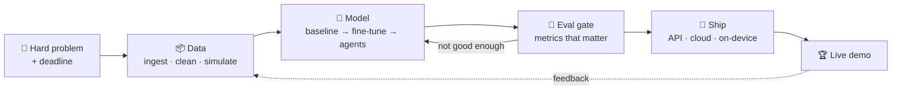

<!-- Generated from README.template.md by tools/build.py. Edit the template, not README.md. -->

<p align="center">
  <a href="https://megh4tech.vercel.app/"></a>
</p>

<p align="center">
  <a href="https://megh4tech.vercel.app/"></a>
</p>

<p align="center">
  <a href="https://megh4tech.vercel.app/"></a>
  <a href="https://www.linkedin.com/in/megh-dave-4a2227314/"></a>
  <a href="https://medium.com/@meghdave2006"></a>
  <a href="mailto:meghdave2006@gmail.com"></a>
</p>

<p align="center">
  
  
  
  
  
</p>

---

### ⚡ TL;DR

I'm **Megh**, an **AI/ML and full stack engineer** from Mumbai. I've worked with **5+ startups, from pre-seed to funded**, on everything from SLAM and spatial AI to agents, fine-tuned LLMs and production apps.
B.Tech CSE (Data Science) at **D.J. Sanghvi**, with Honours in Computational Finance. I've won a lot of hackathons along the way.

---

### 🧭 What I do

| | Area | What that means |
|---|---|---|
| 🛰️ | **Spatial AI & SLAM** | Visual-inertial odometry (VIO), multi-sensor fusion, camera + IMU pipelines, 3D mapping and localisation from real-world capture |
| 📱 | **App development** | Full stack and mobile: Next.js, React, FastAPI, auth, databases, Docker, Terraform, shipped to production |
| 🤖 | **R&D on agents** | Multi-agent systems, agent swarms, eval gates, self-healing pipelines, LLM councils |
| 🎛️ | **Fine-tuning** | QLoRA, 4-bit quantisation, on-device LLMs (Gemma-2B on MLX), domain-adapted models |
| 👁️ | **Computer vision** | Segmentation (Mask2Former, Swin), detection, CLIP, explainable medical imaging |
| 📚 | **RAG & GenAI** | Multimodal retrieval, vector DBs, grounded LLM apps |

> 🟢 **Available for freelance and startup work.** Give me a hard problem and a deadline. [Let's talk ↓](#-hire-me)

---

### 🛠️ Featured work

<table>
<tr>
<td width="50%" valign="top">

#### 🏭 [Forge](https://forge-surfaces-mauve.vercel.app/)
**An autonomous engineering org in a box.** Describe it in plain English. A swarm of Codex agents builds it in parallel, an eval gate kills the weak attempts, and the result ships itself to a live URL. When it breaks, it heals itself.

🏆 **Winner, ChatGPT / Codex Community Hackathon**
`Agent Swarm` `Codex` `Eval Gate` `Self-healing` `CI/CD`

</td>
<td width="50%" valign="top">

#### 📚 [LitAgent](https://litagent.vercel.app/)
**A multi-agent researcher that reads the literature and writes the review.** It runs a 15-step pipeline across Semantic Scholar, arXiv and PubMed, detects contradictions between studies, and uses an "LLM Council" for peer-review-style debate.

🥉 **2nd Runner-Up, Hackanova 5.0**
`Multi-agent` `RAG` `LangChain` `LLMs`

</td>
</tr>
<tr>
<td width="50%" valign="top">

#### ⚖️ [LawTune](https://github.com/MEGH06/LawTune)
**A legal assistant that speaks 22 Indian languages and runs offline on a phone.** Gemma-2B fine-tuned with QLoRA and quantised to 4-bit for on-device inference.

`Gemma-2B` `QLoRA` `MLX` `4-bit quantisation` `On-device`

</td>
<td width="50%" valign="top">

#### 💸 [Fincognia](https://fincogina.vercel.app/)
**An agentic finance co-pilot for gig workers.** It predicts liquidity risk at **85% accuracy** and heads off EMI defaults before they happen.

🏆 **Winner, Hackxios 2K25 (Innovation track)**
`Agentic AI` `Forecasting` `FinTech`

</td>
</tr>
<tr>
<td width="50%" valign="top">

#### 🛡️ [CyberSecure](https://redact-cybersecure-tau.vercel.app/)
**Intrusion detection over 1M+ network logs at 99%+ recall.** PCAP and live Wireshark capture, anomaly dashboards, Merkle-tree immutable logging, and GenAI threat summaries. *(team project)*

`Next.js` `Scikit-learn` `Merkle Trees` `Groq`

</td>
<td width="50%" valign="top">

#### 🔎 [JigyasaAI](https://jigyasaai.streamlit.app/)
**Multimodal RAG for PDFs.** Ask a question and get back the relevant text *and* images in one answer.

`CLIP` `ChromaDB` `Cloudinary` `Streamlit`

[Code →](https://github.com/MEGH06/JigyasaAI)

</td>
</tr>
</table>

<details>
<summary><b>➕ More builds</b></summary>
<br/>

| Project | What it does | Stack |
|---|---|---|
| **EasyOffRoad** 🏆 | Off-road perception: semantic segmentation of desert terrain for autonomous vehicles | Mask2Former · Swin-Large · PyTorch · Next.js |
| **EcoSort AI** 🏆 | Real-time CV that identifies and sorts plastics, with automated EPR compliance reports | Roboflow · OpenCV · FastAPI · Next.js |
| **Equilibrium.ai** 🥈 | Simulates how systemic risk spreads through a network of financial institutions | ML pipeline · LLM · Backend |
| [**OopsIDidntStudy**](https://github.com/ketan-2905/ed_app) | A last-minute study platform with PanicNotes, CramBot and Quizzard | NLP · React · FastAPI |
| [**Potato Leaf Detection**](https://github.com/MEGH06/Potato-leaf-detection) | Plant-disease CNN with 99%+ accuracy on PlantVillage | PyTorch · TensorFlow · CNN |

</details>

---

### 🏆 Trophy cabinet

| Event | Result | Project |
|---|---|---|
| ChatGPT / Codex Community Hackathon | 🏆 **Winner** | Forge |
| Hackniche 4.0 | 🏆 **Winner** | EcoSort AI |
| Hawkathon 2026 | 🏆 **Winner** | EasyOffRoad |
| Hackxios 2K25 (Innovation track) | 🏆 **Winner** | Fincognia |
| Hackanova 5.0 | 🥉 2nd Runner-Up | LitAgent |
| Datathon 2026 | 🥈 Runner-Up | Equilibrium.ai |
| Co-Code Hackathon, DJ Sanghvi | 🥉 2nd Runner-Up | — |
| DJS Sanshodhan (research symposium) | 🥉 2nd Runner-Up | — |

<sub>The full list, with more podiums, is on <a href="https://megh4tech.vercel.app/">my portfolio</a>.</sub>

---

### 🔬 Research

- **Inverse Physics-Informed Neural Networks (PINNs)**: a framework that estimates hidden plant-transpiration parameters from time-series data. It uses LSTM temporal encoding and TimeGAN perturbation so it still works on sparse, noisy data and on climates it hasn't seen.
- **Explainable ConvNeXt ensemble for cervical-cancer detection** *(presented)*: SHAP and attention analysis, so clinicians can question the prediction instead of just trusting it.
- **Federated learning** *(ongoing, paper in progress)*: training across distributed devices without the raw data ever leaving them.

---

### 🧰 Stack

<p align="center">
  <br/>
  
</p>

<p align="center">
  
  
  
  
  
  
  
  
  
  
  
</p>

```bash
$ whoami
megh dave: ai/ml + full stack engineer, part researcher, part hackathon goblin

$ cat focus.txt
SLAM / VIO · agentic AI · fine-tuning · computer vision · RAG · apps

$ cat superpower.txt
"I'm water." Drop me into any stack and I take its shape.

$ uptime
caffeinated since forever ☕   # 200+ juniors mentored at DJS Compute along the way
```

---

### 🧪 How I build



---

### 📊 Proof of work

<p align="center">
  
  
</p>
<p align="center">
  
</p>

<p align="center">
  
</p>

<p align="center">
  <picture>
    <source media="(prefers-color-scheme: dark)" srcset="https://raw.githubusercontent.com/{{USER}}/{{USER}}/output/github-snake-dark.svg"/>
    
  </picture>
</p>

---

<details>
<summary><b>🕹️ Easter egg: spin my brain in 3D (drag to rotate)</b></summary>
<br/>

A neural network you can rotate, generated by [`tools/gen_neural_stl.py`](./tools/gen_neural_stl.py).

```stl
{{STL}}
```

</details>

---

### 🤝 Hire me

<table>
<tr><td>

**Startups, I'm for hire.** 🏷️ *Bikaau brand, premium edition.*

5+ startups so far, from pre-seed to funded. Here's what I can own for yours:

| I can own… | …like I did in |
|---|---|
| 🛰️ SLAM, VIO & sensor fusion | startup work (under NDA) |
| 🤖 Agentic AI & multi-agent systems | Forge, LitAgent, Fincognia |
| 🎛️ Fine-tuning & on-device LLMs | LawTune |
| 📚 RAG & generative AI apps | JigyasaAI, LitAgent |
| 👁️ Computer vision | EasyOffRoad, EcoSort AI |
| 📱 Apps: full stack, backend, APIs, auth, DBs, Docker, Terraform | across all of the above |

📬 **[meghdave2006@gmail.com](mailto:meghdave2006@gmail.com)** · [LinkedIn](https://www.linkedin.com/in/megh-dave-4a2227314/) · [Portfolio](https://megh4tech.vercel.app/)

</td></tr>
</table>

<p align="center">
  
</p>
