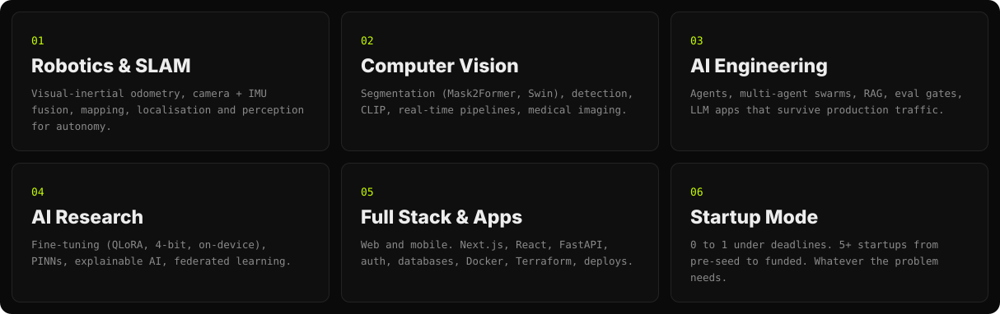
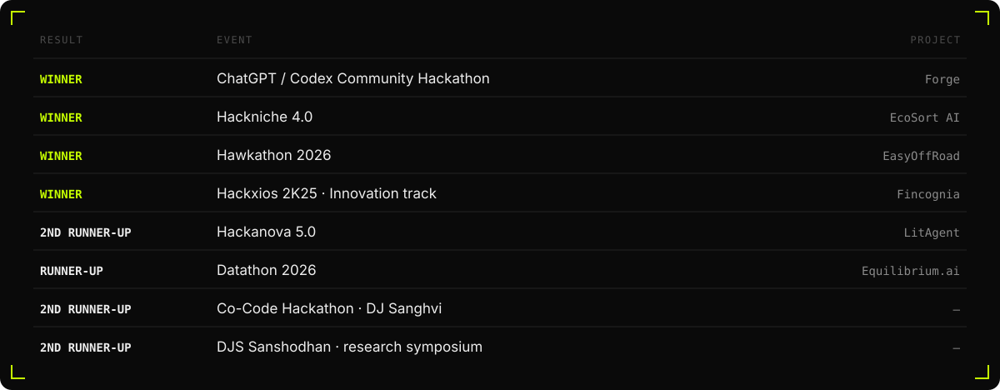
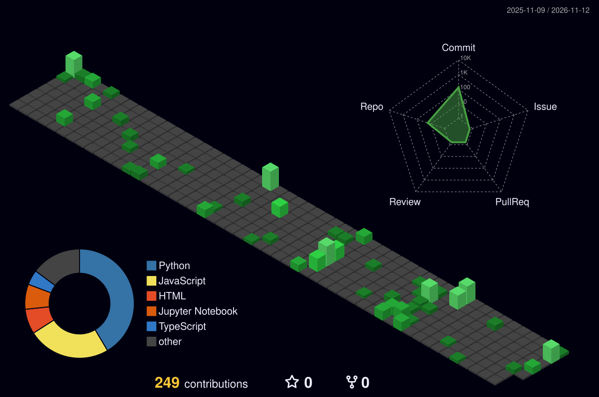

<!-- Generated by tools/build.py from README.template.md + content.json. Edit those, not README.md. -->

  
  
  
  

**Robotics. Computer vision. AI engineering. AI research. Full-stack apps.** I don't stay in one lane. I take whatever the problem needs and ship it.
I've worked with **5+ startups, from pre-seed to funded**, and I'm open to the next one.

{{CARDS}}

<b>More builds</b>

 

| Project | What it does | Stack |
|---|---|---|
| **EcoSort AI** (winner, Hackniche 4.0) | Real-time CV that identifies and sorts plastics, with automated EPR compliance reports | Roboflow, OpenCV, FastAPI, Next.js |
| **Equilibrium.ai** (runner-up, Datathon 2026) | Simulates how systemic risk spreads through a network of financial institutions | ML pipeline, LLM, backend |
| [**JigyasaAI**](https://github.com/MEGH06/JigyasaAI) | Multimodal RAG for PDFs that returns both text and images in one answer | CLIP, ChromaDB, Streamlit |
| [**OopsIDidntStudy**](https://github.com/ketan-2905/ed_app) | Last-minute study platform: PanicNotes, CramBot, Quizzard | NLP, React, FastAPI |
| [**Potato Leaf Detection**](https://github.com/MEGH06/Potato-leaf-detection) | Plant-disease CNN, 99%+ accuracy on PlantVillage | PyTorch, TensorFlow |

- **Inverse Physics-Informed Neural Networks (PINNs).** Estimating hidden plant-transpiration parameters from time-series data, with LSTM temporal encoding and TimeGAN perturbation so it holds up on sparse, noisy data and on climates it hasn't seen.
- **Explainable ConvNeXt ensemble for cervical-cancer detection** *(presented).* SHAP and attention analysis, so a clinician can question the prediction instead of just trusting it.
- **Federated learning** *(ongoing, paper in progress).* Training across distributed devices without the raw data leaving them.

  
  
  
  
  
  
  
  
  
  
  
  
   
  
  
  
  
  
  
  
  

**Building something hard? I'm for hire.** Robotics, vision, AI, research or the full product: I'll own it from first commit to production.
Email **[meghdave2006@gmail.com](mailto:meghdave2006@gmail.com)** or message me on [LinkedIn](https://www.linkedin.com/in/megh-dave-4a2227314/). The full story is on [megh4tech.vercel.app](https://megh4tech.vercel.app/).

B.Tech CSE (Data Science), D.J. Sanghvi · Honours in Computational Finance · ML mentor at DJS Compute, 200+ people guided
